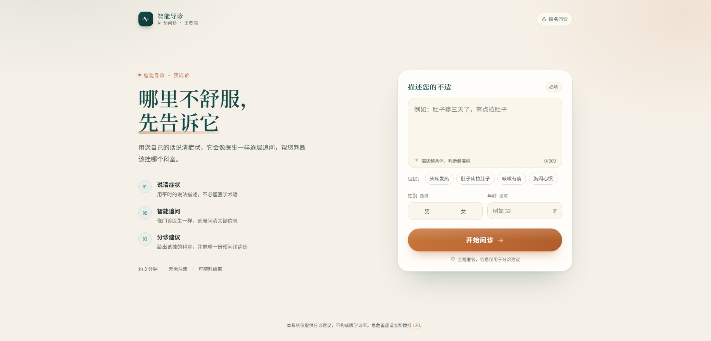
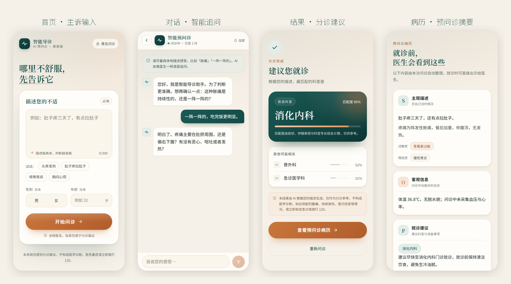
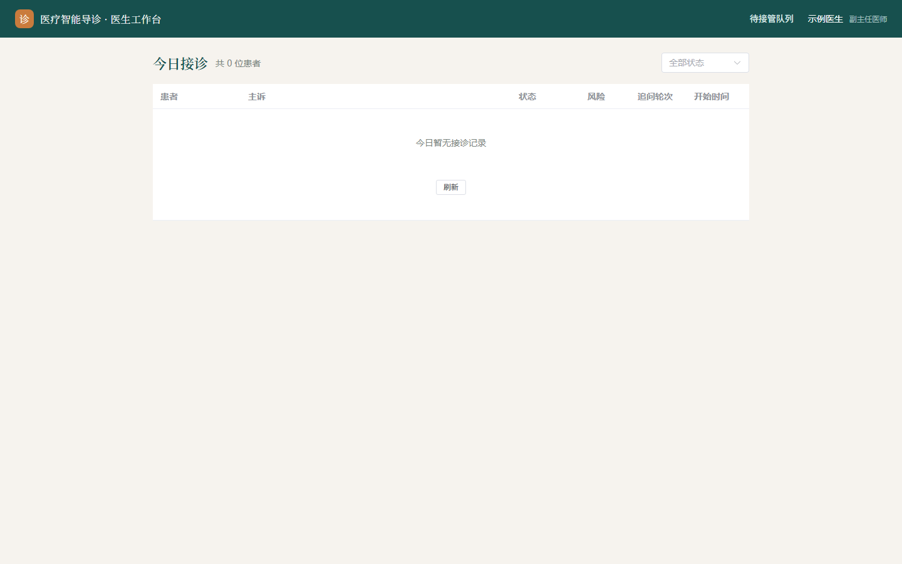
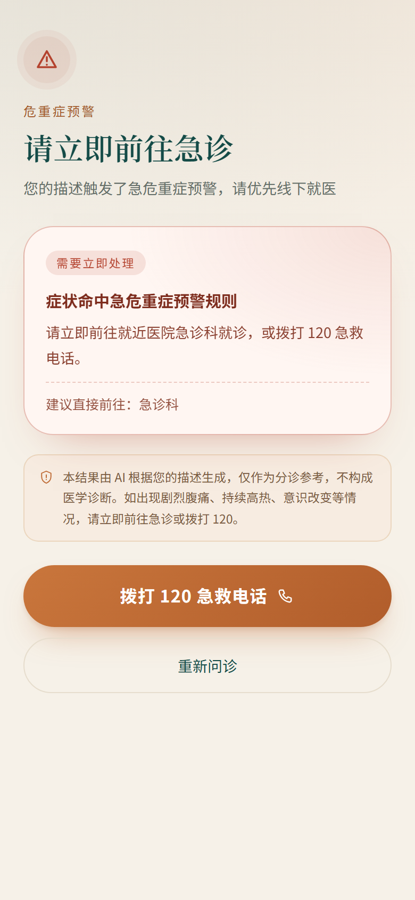
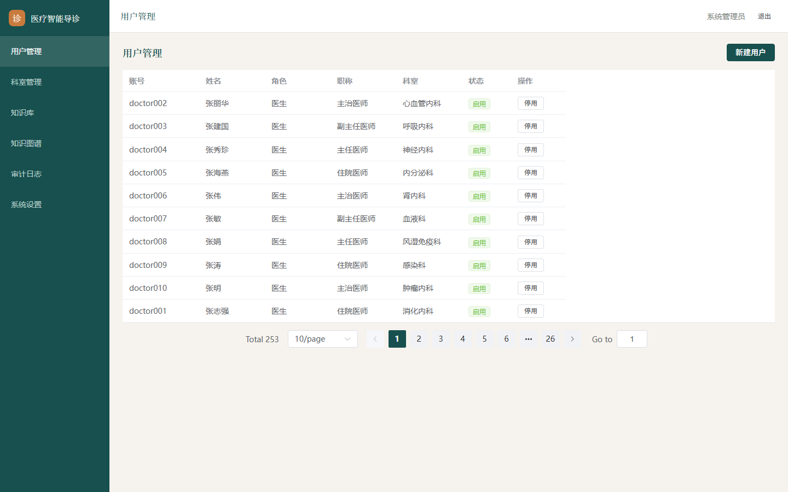

# MedicalGuidance

[](https://github.com/freeCode454/medical-guidance/actions/workflows/ci.yml)
[](https://www.python.org/)
[](https://nodejs.org/)
[](LICENSE)

医疗智能导诊分诊与多学科会诊**多智能体**系统。

患者用手机描述症状，系统通过多轮追问把模糊主诉问清楚，给出「该挂哪个科」和一份 SOAP 预问诊病历；
医生端接诊时直接看结论，管理后台维护知识库与系统配置。系统**不做诊断**，只把「人工分诊台」与
「医生开场问诊」这两段最耗时、最容易出错的环节提前完成。



## 现在能验证什么

仓库内**可复现**的质量证据（不是效果宣传）：

| 项目 | 结果 | 位置 |
|---|---|---|
| 后端单元测试 | 55 passed | [`backend/tests/unit`](backend/tests/unit) |
| 静态检查 | ruff 0 / mypy 0 | [CI](.github/workflows/ci.yml) |
| 端到端冒烟 | 完整问诊 + 红旗拦截（需真实 PG/Milvus/LLM） | [`test_e2e_smoke.py`](backend/tests/test_e2e_smoke.py) |
| 典型主诉回归 | 8/8（含胸痛→心血管内科、胸口疼冒冷汗→急诊） | [工程质量报告](docs/05-工程质量报告.md) |
| 三端构建 | typecheck + build 全过 | [CI](.github/workflows/ci.yml) |

> 旧版 README 里的「200 例盲测 / 96.2% / Kappa 0.86」没有可复现数据，已移除。
> 真实世界评测方案与当前数字口径见 [docs/05-工程质量报告.md](docs/05-工程质量报告.md) §5。

## 核心链路

```
                    ┌─────────────────────────────┐
                    │      危重症前置拦截          │  规则层优先，命中即中断
                    └──────────────┬──────────────┘
                                   │ 通过
患者描述症状 ──────► 澄清追问 Agent ─┴─► 导诊分流 Agent ──► MDT 会诊 Agent ──► 病历生成 Agent
  (文字/语音/点选)     多轮循环           混合检索+决策表      多专科并行          SOAP 病历
```

- **危重症拦截**：250 条红旗规则 + 症状同义词归一化 + 硬编码兜底；**每一轮患者回答都会重新过规则**，
  不是只看首轮主诉。
- **澄清追问**：按主诉类型走模板（部位→时长→性质→伴随→程度），有轮次上限；LangGraph `interrupt/resume`
  保证「回答」与「原问题」配对。
- **分诊**：稠密+稀疏向量 RRF → rerank 精排 → 规则加权 → 人群硬过滤（性别/年龄）→ LLM 只在候选科室里选，
  不允许编造 `dept_code`。
- **知识图谱**：`(症状)-[:INDICATES]->(疾病)-[:BELONGS_TO]->(科室)` 作为第 4 个排序信号（权重 0.15），
  同时把推理路径挂到结论上供医生查看。
- **SOAP 病历**：S/O/A/P 四段，A 段仅医生端可见，P 段禁止用药建议；生成失败降级 PARTIAL，不伪造。
- **医生闭环**：非急诊结论进入待接管队列；医生接管后进入「今日接诊」，确认幂等、修正留痕并作为评测样本。

## 工程亮点

1. **数据出域守卫是代码级约束**：按能力分类（绝对 PII / 患者链路 / 非 PII）+ 策略（strict / dev_sandbox）
   做双重校验，`dev_sandbox` 放行必须声明合成数据并留痕；有单元测试锁死。
2. **可观测性**：每个响应带 `X-Trace-ID`，访问日志与异常堆栈共用同一 id；`/healthz` 存活、`/readyz` 检查
   PostgreSQL + Milvus，依赖挂了会被网关摘流量。
3. **认证生命周期完整**：access/refresh 双令牌，refresh 真正可用且**轮换**（`jti`）；登录失败统一文案、
   账号锁定、bcrypt 放线程池；前端单飞刷新并重放失败请求。
4. **一致性**：会话消息序号用 PostgreSQL advisory lock 串行化；分诊/病历落库幂等；后台任务异常不再静默。
5. **质量门禁**：ruff + mypy + 55 个单测 + 三端 typecheck/build，GitHub Actions 每次 push/PR 全跑；
   `pre-commit` 本地对齐。
6. **诚实的数据视图**：分诊摘要、风险标记、SOAP 内容都落 JSONB 快照，接口返回真实生成内容，
   不再用写死占位符拼页面。

## 界面

| 患者端（四页 + 急诊） | 医生端 |
|---|---|
|  |  |

| 危重症引导 | 管理后台 |
|---|---|
|  |  |

## 技术栈

| 层 | 选型 |
|---|---|
| 患者端 | Vue 3 + Vite + Vant 4（移动端 H5，按需引入） |
| 医生端 / 管理后台 | Vue 3 + Element Plus |
| 接口 | FastAPI + WebSocket（节点级事件推送） |
| 编排 | LangGraph（有环状态机、interrupt/resume、Send 并行会诊） |
| 模型 | Qwen2.5-32B / 7B；BGE-M3 本地 ONNX 向量化 + bge-reranker-v2-m3 精排 |
| 存储 | PostgreSQL + Milvus（稠密/稀疏混合）+ Neo4j（知识图谱）；Redis / MinIO 可选 |
| 质量 | ruff + mypy + pytest + GitHub Actions + pre-commit |

## 目录结构

```
medical-guidance/
├── docs/                    # 01 需求 / 02 架构 / 03 数据库 / 04 接口 / 05 工程质量报告
├── backend/
│   ├── app/
│   │   ├── api/             # 接口层（patient / doctor / admin / kb / auth / ws）
│   │   ├── services/        # 业务用例、规则引擎、编排、事务与审计
│   │   ├── agents/          # LangGraph 图与节点（safety / inquiry / router / mdt / emr）
│   │   ├── retrieval/       # 向量化、Milvus 客户端、RRF 融合
│   │   ├── common/          # 配置 / 数据库 / 鉴权 / LLM 客户端 / 出域守卫 / trace 上下文
│   │   ├── middleware/      # trace-id、访问日志、安全响应头
│   │   ├── models/          # SQLAlchemy 模型（23 张表）
│   │   ├── schemas/         # 请求 / 响应模型
│   │   └── ws/              # 事件总线与事件定义
│   ├── scripts/             # 种子数据、知识库生成/导入、图谱构建
│   ├── tests/               # 单元测试 + 端到端冒烟
│   └── static/              # 本地托管的 Swagger UI 资源
├── frontend/
│   ├── patient_h5/          # 患者端 H5
│   ├── doctor_web/          # 医生工作台
│   └── admin_web/           # 管理后台
├── kb/                      # 知识库源数据（Excel）+ 规则文件
├── deploy/                  # docker-compose 基础设施 + init.sql
└── Makefile                 # 常用命令（含 make verify）
```

## 快速开始

**环境**：Docker Desktop、Python 3.11（建议 conda）、Node 22+。

```bash
# 1. 后端依赖（pyproject 是唯一来源）
conda create -n medguide python=3.11 -y
conda activate medguide
pip install -e "backend[dev]"

# 2. 基础设施（本机内存有限时逐个起）
make db-up        # PostgreSQL（自动执行 init.sql 建 23 表）
make vector-up    # Milvus Standalone
make cache-up     # Redis（可选）

# 3. 配置
cp backend/config/.env.development.example backend/.env
#   至少填 LLM_API_KEY；开发形态显式设置 EGRESS_POLICY=dev_sandbox

# 4. 启动后端
make dev                  # http://localhost:8000
make ready                # /readyz：PostgreSQL + Milvus 是否就绪

# 5. 演示数据（Excel 已在 kb/，可跳过 gen）
cd backend
python scripts/seed_dev.py
python scripts/import_kb.py
python scripts/init_dev_passwords.py   # ⚠️ 种子哈希是占位符，不跑无法登录
python scripts/build_kg.py             # 可选，需 Neo4j
cd ..

# 6. 三端前端
cd frontend/patient_h5 && npm install && npm run dev   # 5173
cd frontend/doctor_web && npm install && npm run dev   # 5174
cd frontend/admin_web  && npm install && npm run dev   # 5175
```

演示账号：

| 端 | 账号 | 密码 |
|---|---|---|
| 医生端 | doctor01 | admin123 |
| 管理后台（机构管理员） | admin | admin123 |
| 管理后台（知识库管理员） | kbadmin | admin123 |

后端 API 文档：<http://localhost:8000/docs>（Swagger 静态资源本地托管，不依赖公网 CDN）。

> ⚠️ 开发形态需 `EGRESS_POLICY=dev_sandbox`，且**只允许合成数据**；交付形态必须是 `strict`，
> 否则启动校验会拒绝启动。

## 质量门禁

```bash
make lint         # ruff
make typecheck    # mypy（基线）
make test-unit    # 55 个单测，不依赖外部服务
make front-check  # 三端 typecheck + build
make verify       # 以上一次跑完
```

CI 见 [`.github/workflows/ci.yml`](.github/workflows/ci.yml)：后端 lint/typecheck/单测 + 三端矩阵构建。

## 已知限制

不藏着掖着，这些问题正在按优先级处理，明细见 [工程质量报告 §4](docs/05-工程质量报告.md#4-仍未解决按优先级)：

- 匿名身份使用「高熵设备密钥 + 服务端只存指纹」，但密钥仍保存在 localStorage，存在 XSS 读取风险，高风险操作也未做二次校验；
- 病历调阅尚未强制校验 `PatientConsent`；
- LangGraph 检查点仍是 `InMemorySaver`，重启/多 worker 会丢挂起会话；
- 接管/确认/修正已加条件更新与行锁，但还缺基于真实 PG 的并发回归测试；
- 知识库发布/入库链路还没有真正的 worker 与向量库同步；
- 医生端/管理后台首屏包体偏大（Element Plus 全量）。

## 文档

| 文档 | 内容 |
|---|---|
| [01-需求规格说明书](docs/01-需求规格说明书.md) | 功能/非功能需求与业务规则 |
| [02-系统架构设计说明书](docs/02-系统架构设计说明书.md) | 分层架构、ADR、出域守卫、中间件 |
| [03-数据库设计说明书](docs/03-数据库设计说明书.md) | 23 张表、索引、Redis 键、RLS |
| [04-API接口设计说明书](docs/04-API接口设计说明书.md) | REST/WS 接口与错误码 |
| [05-工程质量报告](docs/05-工程质量报告.md) | 本轮审计、修复、未修项与数字口径 |

## License

[MIT](LICENSE)
