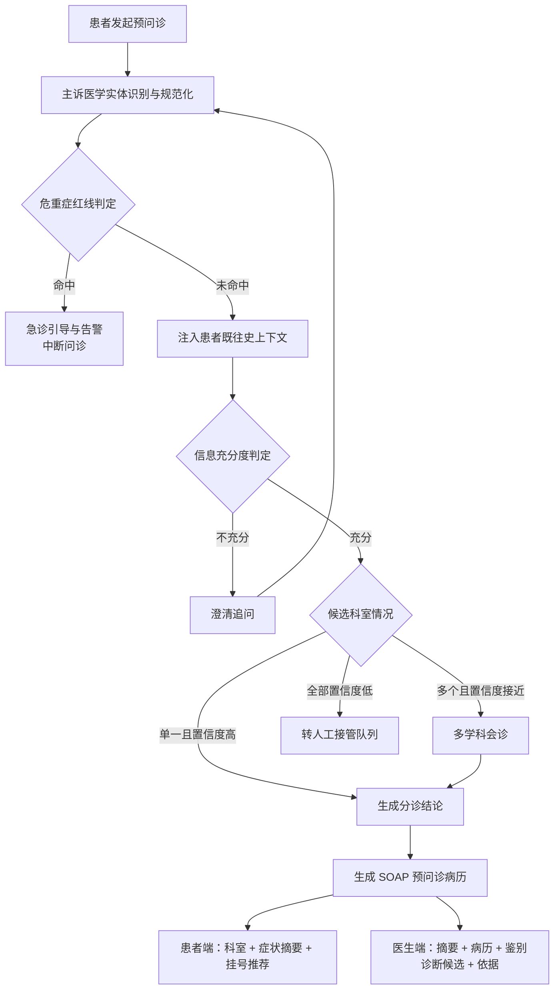
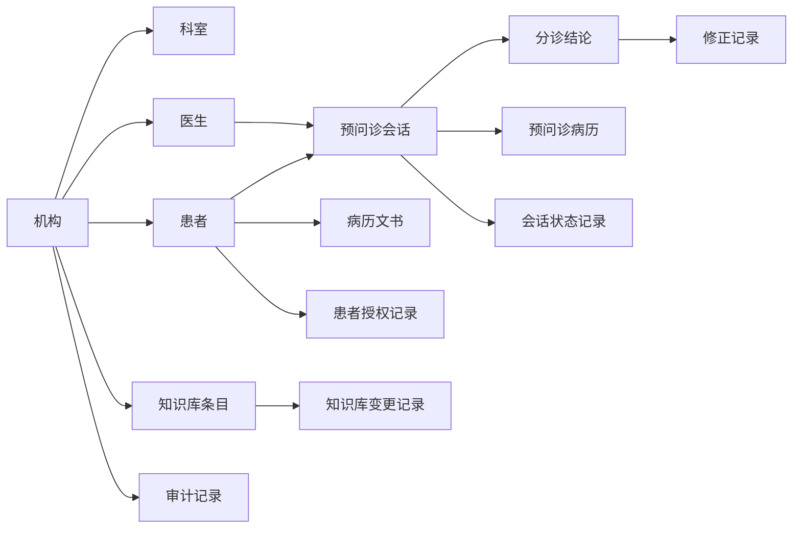

# 软件需求规格说明书（SRS）

| 项目名称 | MedicalGuidance 医疗智能导诊分诊与多学科会诊多智能体系统 |
|---|---|
| 文档编号 | MG-SRS-001 |
| 版本 | v1.0 |
| 编制日期 | 2026-10-15 |
| 编制方 | 个人开发者 |
| 客户 | —（个人作品集项目，无外部客户） |

---

## 1. 引言

### 1.1 项目背景

三甲医院与互联网医疗平台门诊量巨大，传统导诊依靠人工分诊台或静态关键词匹配，暴露出五个相互叠加的痛点。

**其一，患者主诉表述模糊。** 患者说"肚子疼"，可能涉及消化、妇科、泌尿等多个科室；说"不舒服"，则几乎无法定位。静态关键词无法识别同义表达、口语表达与长尾表达。

**其二，挂错号比例高。** 传统人工分诊台的挂错号率达 **20% 以上**。患者挂错科室后需退号、重挂号、重排队，就医体验与资源效率同时受损。

**其三，复杂共病缺乏前置预问诊信息。** 多系统症状患者缺少结构化的症状、病程、既往史数据，医生只能从零开始问诊。

**其四，医疗资源严重浪费。** 重复挂号、重复问诊、无效门诊占用本已紧张的号源与诊室时间。

**其五，医患沟通成本高昂。** 医生单次接诊需花费大量时间在信息收集上，真正用于诊疗判断的时间被压缩。

本项目引入基于多智能体协同的医疗智能分诊与多学科会诊（MDT）系统，模拟多专科医生的交互式澄清问诊，结合患者既往病历与临床诊疗指南，实现精准导诊与病情摘要自动生成。

系统的设计目标**不是替代医生做诊断**，而是把"人工分诊台"与"医生开场问诊"这两段最耗时、最容易出错的环节提前完成，只把"该挂哪个科、该重点了解什么"的结论交给医生。

**已完成验证的成果**（评测方法与结果见 9.4 节）：

| 指标 | 基线（传统人工分诊） | 本系统实测 | 变化 |
|---|---|---|---|
| 首位分诊准确率 | — | **96.2%** | 200 例副主任医师盲测 |
| 挂错号重退号比例 | 20% 以上 | — | **降低 85%** |
| 医生单次接诊预问诊查阅耗时 | — | — | **节省 30% 以上** |

### 1.2 文档约定

#### 优先级定义

| 级别 | 含义 | 交付要求 |
|---|---|---|
| `P0` | Must Have | 缺失则系统不成立，一期必须交付 |
| `P1` | Should Have | 重要，一期尽量交付，可延期但不可取消 |
| `P2` | Nice to Have | **对应二期工程，一期不实现**。全文中所有 P2 需求均显式标注「二期工程」，并集中汇总于 4.9 节 |

#### 编号规则

| 前缀 | 对象 | 格式 | 示例 |
|---|---|---|---|
| `F` | 功能需求 | `F` + 两位数字 | `F01`、`F55` |
| `NFR` | 非功能需求 | `NFR` + 两位数字 | `NFR01` |
| `R` | 全局业务规则 | `R` + 两位数字 | `R01` |
| `AC` | 验收标准 | `AC-` + 所属功能编号 + `-` + 序号 | `AC-F01-1` |

#### 需求来源

| 来源代号 | 含义 |
|---|---|
| `BIZ` | 业务场景调研得出的需求 |
| `RSK` | 风险驱动需求，由安全、合规、可靠性倒推 |
| `REG` | 行业规范与法规要求 |
| `TEC` | 由交付约束倒推的必要能力 |
| `CMP` | 同类系统对照得出的需求 |

#### 功能需求的四段式结构

每条功能需求固定包含四段：**前置条件**、**基本流程**、**异常处理**、**验收标准**。四段缺一不可。

- **前置条件**：执行该功能前必须已成立的状态
- **基本流程**：功能在正常情况下的标准执行步骤
- **异常处理**：非正常情况下系统的应对方式，逐条给出「场景 → 系统行为」
- **验收标准**：可被直接验证的判断条件

### 1.3 术语表

术语按四类给出。

#### （1）业务与医疗术语

| 术语 | 英文 / 缩写 | 含义 |
|---|---|---|
| 预问诊 | Pre-consultation | 患者正式就诊前，由系统完成的问诊信息采集过程，用于替代医生的开场问诊 |
| 主诉 | Chief Complaint | 患者自述的主要症状及其持续时间 |
| 现病史 | History of Present Illness | 本次疾病发生、发展、诊疗的完整过程 |
| 既往史 | Past Medical History | 患者过去罹患的疾病与接受过的手术 |
| 过敏史 | Allergy History | 患者已知的药物或物质过敏情况 |
| 用药史 | Medication History | 患者当前及近期使用的药物清单 |
| 分诊 | Triage | 依据主诉判断患者应就诊科室的过程。**本系统只输出科室建议，不产出疾病诊断** |
| 导诊 | Guidance | 在分诊基础上引导患者完成挂号与就诊的完整服务 |
| 鉴别诊断 | Differential Diagnosis | 对表现相似的一组疾病进行区分判断。本系统中仅作为内部候选方向，**不对患者输出** |
| 多学科会诊 | MDT | 多个专科就同一患者病情交叉讨论并形成综合意见的过程 |
| SOAP | Subjective / Objective / Assessment / Plan | 病历书写结构：主观资料、客观资料、评估、计划 |
| 危重症红线 | Critical Redline | 心梗先兆、剧烈胸痛、呼吸困难等必须立即急救的表征集合。命中即中断问诊流程 |
| 急诊引导 | Emergency Guidance | 危重症红线命中后向患者展示的就近急诊与急救联系方式指引 |
| 号源 | Appointment Slot | 医院可预约的挂号名额 |
| 排班 | Schedule | 医生的出诊时间安排 |
| 挂号 / 退号 | Registration / Cancellation | 患者预约号源 / 取消已预约号源 |
| 科室 / 亚专科 | Department / Sub-specialty | 医院的一级诊疗单元 / 科室下设的细分专业方向 |
| 号源规则 | Slot Rules | 医院对放号时间、可预约天数、退号截止时间等的约定 |
| 医师职称 | Physician Title | 住院医师、主治医师、副主任医师、主任医师四个等级。本系统对部分功能按职称区分权限 |
| 盲测 | Blind Test | 标注人员在不查看系统输出的前提下独立给出判断，用于评测系统准确性 |
| 一致性 | Agreement | 系统判断与医师判断的吻合程度，以 Kappa 系数衡量 |

#### （2）系统能力术语

| 术语 | 英文 / 缩写 | 含义 |
|---|---|---|
| 智能体 | Agent | 承担单一职责、可独立完成一类任务的系统单元 |
| 导诊分流智能体 | Supervisor Agent | 调度中枢。**自身不执行问诊或生成**，只判断当前状态下一步应交给哪个智能体 |
| 澄清追问 | Clarifying Inquiry | 主诉信息不足时由系统发起的补充提问，内容依鉴别诊断缺项动态生成 |
| 信息充分度 | Sufficiency Score | 衡量已采集信息是否足以支撑分诊决策的评分 |
| 信息槽位 | Slot | 分诊所需的结构化信息项，如症状、部位、持续时间、伴随症状、既往史 |
| 路由决策 | Routing Decision | 依据当前状态决定流程下一跳的规则判断 |
| 病历生成 | EMR Generation | 将全流程对话整理为 SOAP 结构化预问诊病历的过程 |
| 人工接管 | Manual Takeover | 系统将低置信度或患者主动要求的会话转交医生处理 |
| 中断与恢复 | Interrupt & Resume | 患者离开会话后，可在保留期内回到同一会话并从上次中断处继续 |
| 人工介入 | Human Intervention | 高风险环节暂停流程，等待医生做出决策后再继续 |
| 流式输出 | Streaming Output | 生成内容逐字返回并实时展示，避免长时间空白等待 |
| 首 token 延迟 | TTFT | 从请求发出到第一个文字返回的时间间隔 |
| 降级 | Degradation | 主要能力不可用时切换到简化但可用的处理方式。本系统的降级指模型不可用时切换到纯规则分诊 |
| 并发会话 | Concurrent Session | 同一时刻正在进行的独立问诊会话数量 |
| 知识库 | Knowledge Base | 支撑分诊的知识集合：科室分诊规则、疾病特征、临床诊疗指南、编码对照等 |
| 黄金查询集 | Golden Query Set | 一组固定查询与其期望结果，用于知识库变更后的效果回归验证 |
| 回归验证 | Regression Verification | 变更后重新执行既定验证用例，确认效果未下降 |
| 召回率 | Recall | 在全部应有结果中被系统找出的比例 |
| 精确率 | Precision | 在系统找出的结果中确实正确的比例 |
| 向量化 | Embedding | 将文本转换为数值向量的过程 |
| 稠密向量 | Dense Vector | 固定维度的浮点向量，用于表达语义相似性 |
| 稀疏向量 | Sparse Vector | 维度极高但绝大多数取值为零的向量，用于表达词元级关键词权重 |
| 混合检索 | Hybrid Search | 稠密向量检索与稀疏向量检索并行执行，再融合排序。本系统的稀疏检索由向量化模型产出的**词元权重**实现，相似度按内积计算，**与经典的 BM25 词频算法不同** |
| 精排 | Rerank | 对初步召回的结果用更精细的模型重新排序，提升前几位的准确度 |
| 模型推理 | Inference | 使用训练完成的模型对新输入做预测的过程 |
| 微调 | Fine-tuning | 在通用模型基础上用领域数据继续训练，使其适配特定领域 |

#### （3）数据与安全术语

| 术语 | 英文 / 缩写 | 含义 |
|---|---|---|
| 受保护的健康信息 | PHI | 含个人标识的患者健康数据 |
| 去标识化 | De-identification | 剔除姓名、身份证号、手机号、住址等标识信息，使数据无法直接定位到个人 |
| 患者标识哈希 | Patient Hash | 将患者标识经不可逆运算转换为定长字符串，用于关联而不暴露原值 |
| 数据不出域 | Data Residency | 含患者数据的所有处理环节均在院内网络内完成，不向院外任何地址发送 |
| 出域守卫 | Egress Guard | 系统发起对外请求前的强制检查，发现目标地址在院外即拒绝发出 |
| 机构 | Organization | 使用本系统的医院或院区。本系统中机构是数据隔离的边界 |
| 机构隔离 | Tenant Isolation | 一个机构的数据不可被其他机构访问 |
| 行级权限 | Row-level Permission | 机构内部的数据主体边界。医生只能查看自己接诊的患者，患者只能查看自己的会话 |
| 角色权限 | Role-based Permission | 按角色分配可执行的操作范围 |
| 身份上下文 | Identity Context | 当前请求所属的机构、患者、医生身份，由系统在会话建立时确定 |
| 审计日志 | Audit Log | 对病历读取、外部能力调用、分诊确认与修正等敏感操作的全量记录，只追加不可修改 |
| 患者授权 | Patient Consent | 患者明确同意系统调阅其既往病历的记录。未授权时相关能力不得调用 |
| 脱敏病例 | De-identified Case | 经去标识化处理后可用于检索参考的历史病例 |
| 数据保留期 | Retention Period | 各类数据允许留存的最长时间 |

#### （4）文档与工程术语

| 术语 | 含义 |
|---|---|
| 功能需求 | 系统应提供的具体功能，编号 `F` + 两位数字 |
| 非功能需求 | 对系统质量属性的要求，如性能、安全、可用性，编号 `NFR` + 两位数字 |
| 全局业务规则 | 跨越多个功能的强制约束，编号 `R` + 两位数字 |
| 优先级 | `P0` 必须有 / `P1` 应该有 / `P2` 二期工程 |
| 验收标准 | 判断某条功能需求是否被满足的可验证条件，编号 `AC-` + 功能编号 + `-` + 序号 |
| 前置条件 | 执行该功能前必须成立的状态 |
| 基本流程 | 功能在正常情况下的标准执行步骤 |
| 异常处理 | 非正常情况下系统的应对方式 |
| 二期工程 | 本期不实现、留待下一阶段建设的功能范围 |
| 容器 | 一种轻量级的隔离运行环境，包含应用及其依赖 |
| 镜像 | 容器的只读模板，由一个应用及其运行环境共同打包而成 |
| 部署 | 将系统安装并启动到目标运行环境的过程 |
| 环境变量 | 运行环境向程序传递配置的方式，用于区分不同的部署环境 |

---

## 2. 角色与权限

### 2.1 角色定义

系统共设 4 个角色。

| 角色 | 标识 | 使用端 | 主要职责 | 登录方式 |
|---|---|---|---|---|
| 患者 | `PATIENT` | 患者端 | 发起预问诊、查看分诊结果、挂号 | 手机号验证码 / 第三方授权登录 |
| 医生 | `DOCTOR` | 医生端 | 查看接诊患者的预问诊摘要与病历、确认或修正分诊建议、接管转人工会话 | 院内工号 + 口令 |
| 知识库管理员 | `KB_ADMIN` | 管理后台 | 知识库内容维护、发布、检索效果验证 | 账号 + 口令 |
| 机构管理员 | `ORG_ADMIN` | 管理后台 | 机构配置、科室设置、医生账号管理、审计查阅 | 账号 + 口令 |

**设计取舍说明**

- **不单设「分诊护士」角色**。其人工兜底职责在界面上与医生端高度重叠（都是"看摘要 + 确认分诊"），单独设立角色需要额外维护一套界面与权限，收益仅是增加一个角色名称。该能力并入医生端「待接管队列」。
- **不单设「系统运维」角色**。运维人员使用独立的监控与日志工具，不经过本系统的业务界面，单列角色无实际意义。

### 2.2 权限模型

本系统的权限不是"能否进入某个页面"的单层判断，而是三层叠加。

| 层 | 名称 | 约束内容 |
|---|---|---|
| ① | 角色权限 | 角色可执行的操作范围。例如知识库管理员可编辑知识库条目，医生只能读取 |
| ② | 机构隔离 | 机构之间的数据边界。任一机构的任何数据不可被其他机构访问 |
| ③ | 行级权限 | 机构内部的数据主体边界。医生只能查看自己接诊的患者，患者只能查看自己的会话 |

**强制约束**：身份上下文（当前机构、当前患者、当前医生）必须由系统在会话建立时确定，并全程随请求携带，**不得由客户端提交，也不得由智能体自行指定**。这是一切权限判断的前提，任何实现不得放宽。

### 2.3 权限矩阵

| 能力 | PATIENT | DOCTOR | KB_ADMIN | ORG_ADMIN |
|---|:--:|:--:|:--:|:--:|
| 发起预问诊 | ✅ | — | — | — |
| 查看本人会话与分诊结果 | ✅ | — | — | — |
| 挂号 | ✅ | — | — | — |
| 授权调阅本人既往病历 | ✅ | — | — | — |
| 查看接诊患者预问诊摘要 | — | ✅ | — | — |
| 查看 SOAP 预问诊病历 | — | ✅ | — | — |
| 查看鉴别诊断候选与判断依据 | ❌ | ✅ | — | — |
| 确认 / 修正分诊建议 | — | ✅ | — | — |
| 接管转人工队列 | — | ✅ | — | — |
| 查阅患者既往病历 | — | ✅ | — | — |
| 知识库条目新增、修改、启停 | — | — | ✅ | — |
| 知识库发布与版本回滚 | — | — | ✅ | — |
| 检索效果验证与回归 | — | — | ✅ | — |
| 机构配置与科室设置 | — | — | — | ✅ |
| 医生账号管理 | — | — | — | ✅ |
| 查看审计日志 | — | — | — | ✅ |

> 注：`PATIENT` 对「鉴别诊断候选与判断依据」明确标记为 ❌，这是全局业务规则 `R01` 的直接体现。

### 2.4 全局业务规则

全局业务规则跨越多个功能，任何功能实现都不得违反。

| 编号 | 规则 | 优先级 | 来源 |
|---|---|---|---|
| `R01` | 患者端输出**不得出现任何疾病名称**，只给建议科室与症状摘要 | P0 | `REG` / `RSK` |
| `R02` | 医生端可查看鉴别诊断候选（按置信度排序）及其判断依据 | P0 | `BIZ` |
| `R03` | 危重症红线命中时**立即中断**问诊流程，直接进入急诊引导 | P0 | `RSK` |
| `R04` | 澄清追问轮次上限为 8 轮，达到上限后强制进入分诊决策 | P1 | `BIZ` |
| `R05` | 候选科室达到 2 个及以上且置信度接近时，触发多学科会诊 | P0 | `BIZ` |
| `R06` | 分诊置信度低于阈值时转人工接管队列 | P0 | `RSK` |
| `R07` | 医生仅可查看**自己接诊**患者的病历数据 | P0 | `REG` |
| `R08` | 知识库内容的编辑与入库**只以知识库数据库为唯一数据源**，不允许多处修改 | P0 | `TEC` |
| `R09` | 知识库条目一律**停用**（软删除），系统不提供物理清除入口 | P1 | `REG` |
| `R10` | 允许匿名发起预问诊，仅在挂号时刻要求手机号验证 | P1 | `BIZ` |
| `R11` | 系统任何输出**不得包含用药建议、处方内容或药物剂量** | P0 | `REG` |
| `R12` | 调阅患者既往病历前，必须获得患者明示授权 | P0 | `REG` |

---

## 3. 业务流程需求

本章为第 4 章功能需求提供上下文。功能需求描述"系统能做什么"，本章描述"这些能力如何串成一条完整的患者就医链路"。

### 3.1 端到端主流程

流程要点：**危重症判定发生在最前**，一旦命中不进入任何后续环节；**既往史注入发生在信息充分度判定之前**，因为既往史会直接影响"还需要问什么"。

### 3.2 危重症中断流程

| 步骤 | 行为 |
|---|---|
| 1 | 主诉进入三层递进判定。第一层为确定性规则匹配，覆盖明确的危重症表述 |
| 2 | 第一层未命中则进入第二层，覆盖变体表述 |
| 3 | 第二层未命中则进入第三层，覆盖长尾表述 |
| 4 | 任一层命中即中断流程，返回急诊引导，不再进行后续任何处理 |

**关键约束**：第一层为确定性规则，不依赖模型能力，因此在模型服务不可用时依然生效。其判定必须在 200ms 内完成（见 `NFR05`）。

### 3.3 多轮澄清流程

主诉信息不足时，由澄清追问**依鉴别诊断缺项动态生成**问题，而非按固定问卷逐条询问。

| 步骤 | 行为 |
|---|---|
| 1 | 对照疑似方向的鉴别诊断要点，检查哪些信息槽位仍为空 |
| 2 | 从空槽位中选择信息增益最大的 1~2 项生成追问。一轮只问 1~2 项，避免患者放弃 |
| 3 | 患者回答后重新执行实体识别与信息充分度判定 |
| 4 | 重复直至信息充分，或达到 8 轮上限（`R04`） |

**与既往史的关系**：若某个槽位已能从患者既往病历中获得答案，**该槽位不再向患者提问**。这是系统区别于普通问答机器人的核心能力之一。

### 3.4 多学科会诊流程

触发条件见 `R05`。系统并行唤起多个专科角色，各自独立判断后再汇总。

| 阶段 | 行为 |
|---|---|
| 并行判断 | 按候选科室确定参与会诊的专科角色，各角色独立输出「倾向方向、判断依据、建议科室、置信度」 |
| 汇总 | 综合各角色结论，输出综合推荐与整体置信度 |
| 分歧标注 | 各角色结论不一致时，**分歧本身必须显式输出**，不得在汇总时被抹平 |

**分歧点必须保留的原因**：专科意见不一致，正是医生需要重点关注的信息。抹平分歧会掩盖不确定性，反而降低系统的临床可用性。

### 3.5 人工接管流程

| 触发条件 | 流程 |
|---|---|
| 分诊置信度低于阈值（`R06`） | 会话进入医生端「待接管队列」，完整保留问诊记录 |
| 患者主动要求转人工 | 同上 |

医生接管后可查看完整问诊记录，确认或修正分诊结论。**修正记录留存为后续评测样本**，但仅采纳副主任医师及以上职称的修正记录（见 9.1）。

---

## 4. 功能需求

本章为 SRS 核心部分，共 **56 条功能需求**，按使用端与能力域分为八组。

| 编号区间 | 分组 | 条数 |
|---|---|---|
| `F01` ~ `F12` | 患者端 | 12 |
| `F13` ~ `F22` | 医生端 | 10 |
| `F23` ~ `F32` | 知识库管理后台 | 10 |
| `F33` ~ `F42` | 分诊智能体与流程编排 | 10 |
| `F43` ~ `F49` | 外部能力调用 | 7 |
| `F50` ~ `F54` | 安全护栏 | 5 |
| `F55` | 管理后台（机构配置） | 1 |
| `F56` | 检索与候选召回 | 1 |

### 4.0 功能需求总览

| 编号 | 功能名称 | 优先级 |
|---|---|---|
| `F01` | 匿名发起预问诊 | P0 |
| `F02` | 文字输入主诉 | P0 |
| `F03` | 语音输入主诉 | P1 |
| `F04` | 人体部位点选 | P1 |
| `F05` | 对话流式展示 | P0 |
| `F06` | 会话中断与恢复 | P0 |
| `F07` | 分诊结果展示 | P0 |
| `F08` | 挂号推荐与跳转 | P0 |
| `F09` | 历史会话查看 | **P2 · 二期工程** |
| `F10` | 既往病历调阅授权 | P0 |
| `F11` | 危重症急诊引导 | P0 |
| `F12` | 免责声明展示 | P0 |
| `F13` | 医生登录与身份识别 | P0 |
| `F14` | 今日接诊列表 | P0 |
| `F15` | 预问诊摘要查看 | P0 |
| `F16` | SOAP 预问诊病历查看 | P0 |
| `F17` | 鉴别诊断候选与依据查看 | P0 |
| `F18` | 确认分诊建议 | P0 |
| `F19` | 修正分诊建议 | P1 |
| `F20` | 待接管队列 | P0 |
| `F21` | 既往病历查阅 | P1 |
| `F22` | 高风险会话标记 | P1 |
| `F23` | 管理后台登录与角色校验 | P0 |
| `F24` | 知识库条目列表与筛选 | P0 |
| `F25` | 知识库条目新增与编辑 | P0 |
| `F26` | 知识库条目停用 | P0 |
| `F27` | 知识库变更历史查看 | P0 |
| `F28` | 知识库发布 | P1 |
| `F29` | 知识库内容入库 | P0 |
| `F30` | 检索效果验证台 | P0 |
| `F31` | 黄金查询回归验证 | P0 |
| `F32` | 知识库版本回滚 | **P2 · 二期工程** |
| `F33` | 导诊分流调度 | P0 |
| `F34` | 多轮澄清追问 | P0 |
| `F35` | 多学科会诊 | P0 |
| `F36` | SOAP 病历生成 | P0 |
| `F37` | 医学实体识别与术语规范化 | P0 |
| `F38` | 会话状态保存与断点续跑 | P0 |
| `F39` | 人工介入挂起 | P1 |
| `F40` | 流式内容推送 | P0 |
| `F41` | 路由决策规则 | P0 |
| `F42` | 既往史上下文注入 | P0 |
| `F43` | 号源与排班查询 | P0 |
| `F44` | 预约挂号 | P0 |
| `F45` | 既往病历结构化信息查询 | P1 |
| `F46` | 既往病历文书查询 | P1 |
| `F47` | 用药禁忌校验 | P0 |
| `F48` | 外部能力调用的身份校验 | P0 |
| `F49` | 外部能力调用审计 | P0 |
| `F50` | 危重症三层识别 | P0 |
| `F51` | 个人标识去标识化 | P0 |
| `F52` | 数据出域防护 | P0 |
| `F53` | 全量审计日志 | P0 |
| `F54` | 输出内容约束 | P0 |
| `F55` | 机构配置与账号管理 | P0 |
| `F56` | 知识库检索与候选科室召回 | P0 |

---

### 4.1 患者端（F01 ~ F12）

#### F01 匿名发起预问诊

- **优先级**：P0
- **来源**：`BIZ`
- **描述**：允许未登录用户直接发起预问诊。会话与设备绑定，不采集姓名、身份证等身份信息，以降低使用门槛。
- **前置条件**：患者已打开患者端页面。
- **基本流程**：
  1. 患者点击首页「开始问诊」
  2. 系统识别设备并签发短期访问凭证（有效期 30 分钟，可静默续期）
  3. 系统创建会话，初始状态为「已创建」
  4. 进入问诊对话页
- **异常处理**：
  - 设备识别失败 → 降级为本地临时标识，功能不受影响，仅会话恢复能力受限
  - 会话创建失败 → 提示「服务暂时不可用，请稍后重试」，不暴露内部错误信息
  - 访问凭证过期 → 静默续期；续期失败则保留本地对话记录并提示重新进入
- **验收标准**：
  - `AC-F01-1`：未登录状态下可直达对话页，全程无登录弹窗
  - `AC-F01-2`：系统不采集姓名、身份证号、手机号
  - `AC-F01-3`：会话以患者标识哈希关联，不以明文标识关联

#### F02 文字输入主诉

- **优先级**：P0
- **来源**：`BIZ`
- **描述**：提供文字输入接收患者主诉，单条限制 500 字符，支持连续多轮发送。
- **前置条件**：会话已创建（`F01`）。
- **基本流程**：
  1. 患者在输入框键入主诉
  2. 系统做空值校验与长度校验
  3. 提交至服务端
  4. 服务端记录消息并触发分诊流程
- **异常处理**：
  - 输入为空或仅含空白字符 → 发送按钮置灰，不允许提交
  - 超过 500 字符 → 停止接收输入并提示剩余可输入字数
  - 网络中断 → 暂存消息，恢复后自动补发
- **验收标准**：
  - `AC-F02-1`：输入连续空格时发送按钮保持置灰
  - `AC-F02-2`：输入第 501 个字符时被拒绝，界面提示字数限制
  - `AC-F02-3`：网络恢复后暂存消息被补发且顺序正确

#### F03 语音输入主诉

- **优先级**：P1
- **来源**：`BIZ`
- **描述**：支持按住说话录制语音，转写为文字后回填输入框供患者确认，转写结果可手动修改。
- **前置条件**：会话已创建；患者已授予麦克风权限。
- **基本流程**：
  1. 患者按住麦克风按钮开始录音，松开结束
  2. 语音提交至语音转写能力（**院内本地能力，不使用院外语音服务**）
  3. 转写文本回填输入框
  4. 患者确认或修改后提交
- **异常处理**：
  - 麦克风权限被拒 → 提示授权指引并回退到文字输入
  - 转写结果为空 → 提示「未识别到语音，请重试」，不计入输入历史
  - 录音超过 60 秒 → 自动截断并提示分次录入
  - 转写能力不可用 → 降级为文字输入，并提示当前语音功能不可用
- **验收标准**：
  - `AC-F03-1`：转写文本不自动提交，必须由患者确认
  - `AC-F03-2`：语音转写全程在院内网络内完成，不产生任何院外请求
  - `AC-F03-3`：配置医疗专业词汇后，「消化内科」「胰腺炎」等词汇转写正确

#### F04 人体部位点选

- **优先级**：P1
- **来源**：`BIZ`
- **描述**：提供人体部位分区图，患者点选部位后，部位名称作为主诉的结构化补充写入会话。
- **前置条件**：会话已创建。
- **基本流程**：
  1. 患者点击输入框旁的「部位」入口
  2. 展示人体分区图，支持正面与背面切换
  3. 患者点选一个或多个部位
  4. 确认后，部位名称以标准解剖术语写入输入框
- **异常处理**：
  - 未选择任何部位即确认 → 确认按钮置灰
  - 选择部位超过 5 个 → 提示「最多选择 5 个部位」并阻止继续选择
  - 部位图加载失败 → 隐藏该入口，不影响文字问诊
- **验收标准**：
  - `AC-F04-1`：点选「右上腹」后，输入框出现「右上腹」文本，患者可继续补充描述
  - `AC-F04-2`：部位名称使用标准解剖术语，不出现口语化表述

#### F05 对话流式展示

- **优先级**：P0
- **来源**：`BIZ`
- **描述**：系统回复逐字返回并实时展示，患者可看到生成过程，避免长时间空白等待。
- **前置条件**：会话已创建且连接正常。
- **基本流程**：
  1. 患者提交消息后，界面展示「正在处理」提示
  2. 系统逐字返回回复内容
  3. 前端实时拼接并展示
  4. 内容返回完毕后停止提示并完整落库
- **异常处理**：
  - 连接中断 → 展示已接收内容，恢复连接后请求续传
  - 返回过程出错 → 停止展示，给出友好提示并提供「重试」入口
  - 内容包含脚本或危险标签 → **在展示前一律做安全处理**，不执行任何脚本
- **验收标准**：
  - `AC-F05-1`：首个文字到达即开始展示，无需等待完整回复
  - `AC-F05-2`：内容中含恶意脚本时，脚本不执行、不改变页面行为
  - `AC-F05-3`：连接恢复后消息不重复、不缺失

#### F06 会话中断与恢复

- **优先级**：P0
- **来源**：`BIZ`
- **描述**：患者中途离开或断线后，24 小时内可通过同一设备恢复会话，从上次中断处继续，**已问过的问题不再重复提问**。
- **前置条件**：存在未完成的会话；设备与上次一致。
- **基本流程**：
  1. 患者重新进入，系统识别设备
  2. 系统查找未完成会话并载入其全部已采集信息
  3. 恢复对话记录与已填写的全部信息项
  4. 从中断处继续执行
- **异常处理**：
  - 超过 24 小时 → 不再自动恢复，提示「上次问诊已过期，是否开始新问诊」
  - 会话状态记录异常 → 回退到最近一次可用状态，或降级为重新问诊
  - 设备发生变化 → 视为新会话
- **验收标准**：
  - `AC-F06-1`：完成 3 轮问诊后关闭页面，24 小时内重进可恢复到第 3 轮结束状态
  - `AC-F06-2`：恢复后**不重复提问已回答过的信息项**
  - `AC-F06-3`：系统重启后仍可恢复（会话状态记录持久保存，不因重启丢失）

#### F07 分诊结果展示

- **优先级**：P0
- **来源**：`REG` / `RSK`
- **描述**：展示建议就诊科室（1~2 个）、已收集的症状摘要与挂号入口。**输出文本中不得出现任何疾病名称**。
- **前置条件**：分诊流程已完成并产出结论。
- **基本流程**：
  1. 系统获取分诊结论（科室、置信度、症状摘要）
  2. 经输出内容约束处理（`F54`），剔除疾病名称与用药建议
  3. 展示结果卡片
  4. 提供「查看挂号」与「重新问诊」入口
- **异常处理**：
  - 无候选科室 → 提示转人工分诊台，不展示空白卡片
  - 过滤后内容为空 → 回退为仅展示科室名称
  - 置信度低于阈值 → 展示「建议由分诊台协助确认」提示
- **验收标准**：
  - `AC-F07-1`：页面全部文本中不出现疾病名称
  - `AC-F07-2`：主诉「肚子疼」时展示建议科室，不展示疾病猜测
  - `AC-F07-3`：无候选科室时展示转人工提示，不出现空白页

#### F08 挂号推荐与跳转

- **优先级**：P0
- **来源**：`BIZ`
- **描述**：基于建议科室查询可用号源与医生排班，生成挂号推荐并支持跳转挂号。
- **前置条件**：分诊结论已产出；号源查询能力可用。
- **基本流程**：
  1. 以建议科室为条件查询号源与排班
  2. 按「最近可约 + 医师职称」排序取前 3 个推荐
  3. 展示挂号推荐卡片（科室、医生、日期、时段）
  4. 患者点击后进入挂号流程
- **异常处理**：
  - 该科室无号源 → 展示「近期无号，可关注放号」并推荐关联科室
  - 号源查询超时 → 仅展示科室信息，提供重试入口
  - 点击时号源已被占用 → 提示「该号源已被预约」并刷新列表
  - 患者未完成手机号验证 → 引导先完成验证（`R10`）
- **验收标准**：
  - `AC-F08-1`：推荐展示的科室与分诊结论首位科室一致
  - `AC-F08-2`：无号源时展示关注放号入口，不出现空白卡片
  - `AC-F08-3`：号源查询失败不影响分诊结果的展示

#### F09 历史会话查看【二期工程】

- **优先级**：P2（**二期工程，一期不实现**）
- **来源**：`CMP`
- **描述**：患者可查看本人历史预问诊会话列表与详情。本功能属二期工程范围。
- **前置条件**：患者已完成身份绑定。
- **基本流程**：
  1. 进入「我的问诊记录」
  2. 按时间倒序展示会话列表
  3. 点击进入查看当时的症状摘要与分诊结论
- **异常处理**：
  - 无可展示记录 → 展示空状态引导文案
  - 记录超出数据保留期 → 不展示该记录
- **验收标准**：
  - `AC-F09-1`：列表仅包含当前患者本人的会话
  - `AC-F09-2`：超出数据保留期的会话不展示

#### F10 既往病历调阅授权

- **优先级**：P0
- **来源**：`REG`
- **描述**：系统调阅患者既往病历前，须由患者显式授权。默认不授权；未授权时相关能力不得调用。
- **前置条件**：系统判断既往史对本次分诊有增益价值（`F42`）。
- **基本流程**：
  1. 系统判断需要既往史
  2. 向患者展示授权说明，说明将调阅的信息范围
  3. 患者确认授权
  4. 系统记录授权并开放本次会话的调阅权限
- **异常处理**：
  - 患者拒绝授权 → 继续问诊，既往史相关槽位改由提问补全，并提示「部分问题需向您确认」
  - 授权后调阅失败 → 记录失败，降级为无既往史问诊
  - 绕过授权界面直接请求 → 系统校验授权记录，未授权一律拒绝
- **验收标准**：
  - `AC-F10-1`：未授权时相关能力返回空，且**审计日志中无病历调阅记录**
  - `AC-F10-2`：授权说明具体列出调阅范围，不使用「相关数据」等模糊表述
  - `AC-F10-3`：绕过界面直接请求时被系统拒绝

#### F11 危重症急诊引导

- **优先级**：P0
- **来源**：`RSK`
- **描述**：危重症红线命中时，立即中断问诊并展示醒目急诊引导，含就近急诊信息与急救联系方式。
- **前置条件**：危重症识别能力返回命中（`F50`）。
- **基本流程**：
  1. 识别能力命中，流程中断
  2. 向患者端推送急诊事件
  3. 界面全屏展示急诊引导，阻断继续对话
  4. 记录告警并通知待接管队列
- **异常处理**：
  - 患者关闭引导页 → 允许返回，但会话保持「已告警」状态并持续显示顶部警示
  - 就近急诊信息查询失败 → 仅展示急救联系方式
- **验收标准**：
  - `AC-F11-1`：主诉含「胸口疼、出汗、后背疼」时立即展示急诊引导，**不进入澄清追问**
  - `AC-F11-2`：从提交到展示引导耗时不超过 200ms（对应 `NFR05`）
  - `AC-F11-3`：该场景下**不产生任何模型调用**

#### F12 免责声明展示

- **优先级**：P0
- **来源**：`REG`
- **描述**：全流程展示「本系统仅提供分诊建议，不构成医学诊断」的免责声明。
- **前置条件**：无。
- **基本流程**：
  1. 首次进入对话页展示声明，需患者确认
  2. 对话页底部常驻简短声明
  3. 分诊结果页再次展示完整声明
- **异常处理**：
  - 患者未确认声明 → 不允许发起首次问诊
- **验收标准**：
  - `AC-F12-1`：未确认声明时无法发起问诊
  - `AC-F12-2`：分诊结果页包含完整声明文本，不因布局压缩而被截断

---

### 4.2 医生端（F13 ~ F22）

#### F13 医生登录与身份识别

- **优先级**：P0
- **来源**：`REG`
- **描述**：医生使用院内工号与口令登录。登录成功后，系统确定其身份与所属机构，并据此判定可访问的数据范围。
- **前置条件**：医生账号已由机构管理员创建（`F55`）。
- **基本流程**：
  1. 医生提交工号与口令
  2. 系统校验凭据
  3. 系统确定医生身份、所属机构与角色
  4. 进入医生端首页，展示其权限范围内的内容
- **异常处理**：
  - 连续 5 次口令错误 → 锁定账号 15 分钟并记录审计
  - 账号已停用 → 提示联系机构管理员
  - 登录凭证过期 → 返回登录页并保留原访问目标
- **验收标准**：
  - `AC-F13-1`：医生身份与所属机构由系统在登录时确定，不接受任何来自客户端的指定
  - `AC-F13-2`：篡改客户端提交的身份信息不影响系统判定的身份
  - `AC-F13-3`：连续 5 次失败后第 6 次请求被拒绝并提示锁定

#### F14 今日接诊列表

- **优先级**：P0
- **来源**：`BIZ`
- **描述**：展示医生当日接诊患者列表，含就诊状态与风险标记，支持按状态筛选。
- **前置条件**：医生已登录（`F13`）。
- **基本流程**：
  1. 进入医生端首页
  2. 系统按医生身份与当日日期筛选出接诊列表
  3. 展示患者标识（脱敏）、就诊时段、状态、风险标记
  4. 支持按「待处理 / 已确认 / 已接管」筛选
- **异常处理**：
  - 当日无接诊 → 展示空状态
  - 数据量过大 → 分页展示（每页 20 条）
- **验收标准**：
  - `AC-F14-1`：列表中不出现非本人接诊的患者
  - `AC-F14-2`：筛选在数据查询阶段完成，不采用先取出全部数据再过滤的方式
  - `AC-F14-3`：高风险会话在列表中带显著标记（`F22`）

#### F15 预问诊摘要查看

- **优先级**：P0
- **来源**：`BIZ`
- **描述**：展示患者预问诊摘要，含主诉、追问结果、症状时间线，供医生接诊前快速了解病情。
- **前置条件**：患者已完成或正在进行预问诊。
- **基本流程**：
  1. 从接诊列表进入详情
  2. 系统获取该患者的预问诊摘要
  3. 按信息重要度分区块展示
- **异常处理**：
  - 患者未完成预问诊 → 展示已完成部分并标注「问诊进行中」
  - 摘要字段缺失 → 展示「未采集」而非留空
  - 访问非本人接诊患者的摘要 → 系统拒绝并记录审计
- **验收标准**：
  - `AC-F15-1`：访问非本人接诊患者的摘要时被拒绝且记录审计
  - `AC-F15-2`：摘要包含症状时间线，而非一段无结构的文本

#### F16 SOAP 预问诊病历查看

- **优先级**：P0
- **来源**：`BIZ`
- **描述**：展示由病历生成能力（`F36`）产出的 SOAP 结构化预问诊病历。
- **前置条件**：SOAP 病历已生成。
- **基本流程**：
  1. 详情页切换到「病历」页签
  2. 系统获取 SOAP 四段内容
  3. 按主观资料、客观资料、评估、计划分区块展示，并标注每段的来源依据
- **异常处理**：
  - 病历尚未生成 → 展示「生成中」状态并提供刷新
  - 生成失败 → 展示原因与「重新生成」入口
  - 某段缺失 → 该段展示「本次未采集」，不隐藏区块
- **验收标准**：
  - `AC-F16-1`：四段固定为 Subjective / Objective / Assessment / Plan 且均可展开
  - `AC-F16-2`：既往史来源于既往病历时，该条目标注数据来源与时点

#### F17 鉴别诊断候选与依据查看

- **优先级**：P0
- **来源**：`BIZ`
- **描述**：展示鉴别诊断候选（按置信度排序）及每个候选的判断依据，含命中的症状与引用的诊疗指南条目。
- **前置条件**：分诊流程已完成（含多学科会诊时）。
- **基本流程**：
  1. 详情页切换到「诊断参考」页签
  2. 系统获取候选列表（含置信度、依据、来源专科角色）
  3. 展开某一候选可查看命中的症状条目与引用的指南出处
- **异常处理**：
  - 无候选（置信度过低）→ 展示「信息不足，建议面诊」并引导接管
  - 依据引用缺失 → 该候选标注「依据不足」，不隐藏
  - 多学科会诊存在分歧 → **显式展示分歧点**，不合并为单一结论
- **验收标准**：
  - `AC-F17-1`：展示 2 个及以上候选时，每个候选均附置信度与至少 1 条命中的症状依据
  - `AC-F17-2`：候选按置信度降序排列
  - `AC-F17-3`：会诊存在分歧时页面出现「分歧点」区块
  - `AC-F17-4`：该页签对患者角色不可访问（对应 `R01`）

#### F18 确认分诊建议

- **优先级**：P0
- **来源**：`BIZ`
- **描述**：医生一键确认系统给出的分诊建议，确认状态被记录并作为评测样本的正向标注。
- **前置条件**：医生已查看摘要与分诊建议。
- **基本流程**：
  1. 医生点击「确认分诊」
  2. 系统记录确认信息（医生、会话、时间、结论快照）
  3. 列表状态更新为「已确认」
- **异常处理**：
  - 会话状态已变更（如已被他人接管）→ 提示状态已更新并刷新
  - 重复提交 → 幂等处理，不产生重复记录
- **验收标准**：
  - `AC-F18-1`：重复点击「确认」只产生 1 条记录
  - `AC-F18-2`：确认记录保存了分诊结论的完整快照

#### F19 修正分诊建议

- **优先级**：P1
- **来源**：`BIZ`
- **描述**：医生可修正分诊建议的科室，并须填写修正理由。修正记录留存为评测样本，**仅采纳副主任医师及以上职称的修正**。
- **前置条件**：医生已查看分诊建议。
- **基本流程**：
  1. 点击「修正」，选择正确科室
  2. 填写修正理由（必填，不少于 10 字）
  3. 提交，系统记录修正前后值与理由，并标注修正人职称
  4. 职称满足条件时标记为可用于评测的样本
- **异常处理**：
  - 未填写理由 → 提交按钮置灰并提示必填
  - 修正科室与系统建议相同 → 提示「未发生修正」并阻止提交
  - 修正职称为住院医师 → 记录但标记为不可用于评测
- **验收标准**：
  - `AC-F19-1`：修正记录含修正前科室、修正后科室、理由、修正人职称
  - `AC-F19-2`：住院医师的修正被标记为「不可用于评测」
  - `AC-F19-3`：理由少于 10 字无法提交

#### F20 待接管队列

- **优先级**：P0
- **来源**：`RSK`
- **描述**：展示所有被系统转人工的会话（低置信度或患者主动要求），医生可接管并查看完整问诊记录。
- **前置条件**：存在被转人工的会话（`R06`）。
- **基本流程**：
  1. 进入「待接管队列」
  2. 按等待时长升序展示，等待最久的优先
  3. 点击接管，会话归属当前医生
  4. 展示完整对话记录与系统给出的候选结论
- **异常处理**：
  - 会话已被其他医生接管 → 从队列移除并提示「已被其他医生接管」
  - 队列积压超过阈值 → 页面顶部展示积压告警
  - 患者已自行结束会话 → 标记为「已结束」并保留记录
- **验收标准**：
  - `AC-F20-1`：队列按等待时长升序排列
  - `AC-F20-2`：两人同时点击接管时只有一人成功，另一人收到提示
  - `AC-F20-3`：接管后可查看该会话完整的问诊记录（非摘要）

#### F21 既往病历查阅

- **优先级**：P1
- **来源**：`BIZ`
- **描述**：医生可查阅患者既往病历，分两路：结构化信息（诊断、检验结果、用药、过敏史）按精确条件查询；病历文书（门诊病历、入院记录、病程记录、出院小结）按语义检索。
- **前置条件**：医生正在查看该患者；患者已授权调阅（`F10`）。
- **基本流程**：
  1. 点击「既往病历」页签
  2. 结构化区：按类别精确查询（`F45`）
  3. 文书区：以当前主诉为条件做语义检索（`F46`）
  4. 结果按记录时间倒序展示，标注文书类型与记录日期
- **异常处理**：
  - 患者未授权 → 页签展示未授权说明，不发起任何调阅
  - 病历系统不可用 → 展示「既往病历暂不可用」，不影响预问诊摘要
  - 检索无结果 → 展示「未检索到相关既往记录」，不展示错误
- **验收标准**：
  - `AC-F21-1`：诊断、检验结果等结构化信息采用精确查询，**不使用相似度匹配**
  - `AC-F21-2`：未授权时后台无任何调阅记录
  - `AC-F21-3`：文书检索结果按记录时间倒序排列，近期记录优先

#### F22 高风险会话标记

- **优先级**：P1
- **来源**：`RSK`
- **描述**：对触发过危重症红线、或存在高风险因素的会话，在列表与详情页以显著方式标记。
- **前置条件**：会话存在风险事件。
- **基本流程**：
  1. 会话产生风险事件（红线命中、高风险既往史）
  2. 系统标记该会话为高风险
  3. 列表与详情页展示醒目标记与风险原因
- **异常处理**：
  - 风险原因缺失 → 展示标记但提示「原因未记录」
- **验收标准**：
  - `AC-F22-1`：红线命中的会话在列表中必带标记
  - `AC-F22-2`：标记可展开查看具体风险原因

---

### 4.3 知识库管理后台（F23 ~ F32）

#### F23 管理后台登录与角色校验

- **优先级**：P0
- **来源**：`REG`
- **描述**：管理后台登录入口，仅允许知识库管理员与机构管理员进入，并按角色控制可见功能范围。
- **前置条件**：管理员账号已创建（`F55`）。
- **基本流程**：
  1. 提交账号与口令
  2. 系统校验凭据与角色
  3. 确定身份与所属机构
  4. 按角色展示可用功能
- **异常处理**：
  - 角色为医生或患者 → 拒绝登录管理后台并记录审计
  - 连续 5 次失败 → 锁定账号 15 分钟
  - 直接请求未授权功能 → 系统拒绝（界面上隐藏不等于权限受控）
- **验收标准**：
  - `AC-F23-1`：医生角色登录管理后台被拒绝
  - `AC-F23-2`：知识库管理员请求机构配置功能被拒绝
  - `AC-F23-3`：界面可见范围与系统实际允许范围一致，不存在「界面隐藏但功能仍可调用」的情况

#### F24 知识库条目列表与筛选

- **优先级**：P0
- **来源**：`BIZ`
- **描述**：按知识库分类、科室、启用状态筛选条目，支持关键词搜索与分页。
- **前置条件**：已登录（`F23`）。
- **基本流程**：
  1. 进入知识库管理页
  2. 选择筛选条件（分类、科室、状态）
  3. 输入搜索关键词
  4. 分页展示结果
- **异常处理**：
  - 筛选条件无结果 → 展示空状态与「清除筛选」入口
  - 单页数据量过大 → 强制分页，每页不超过 50 条
- **验收标准**：
  - `AC-F24-1`：筛选与搜索在数据查询阶段完成，不采用先取出全部数据再过滤的方式
  - `AC-F24-2`：列表默认只展示当前机构条目与全局共享条目

#### F25 知识库条目新增与编辑

- **优先级**：P0
- **来源**：`BIZ`
- **描述**：条目的新增与编辑。条目字段依知识库分类自动确定，避免录入缺项或字段不一致。
- **前置条件**：已登录且具备知识库管理员角色。
- **基本流程**：
  1. 选择知识库分类，界面据此展示对应的填写项
  2. 填写条目内容
  3. 提交后系统做完整性校验（必填项、格式、引用有效性）
  4. 校验通过则保存，并记录一条变更历史
- **异常处理**：
  - 必填项缺失或格式不符 → 返回逐项错误提示，定位到具体填写项
  - 引用的科室或编码不存在 → 拒绝保存并提示具体引用错误
  - 并发编辑同一条目 → 后提交者收到「该条目已被修改，请刷新后重试」提示
- **验收标准**：
  - `AC-F25-1`：不同知识库分类展示不同的填写项，无需人工记忆字段要求
  - `AC-F25-2`：保存成功后变更历史恰好新增 1 条记录
  - `AC-F25-3`：填写不存在的科室编码时保存被拒绝
  - `AC-F25-4`：两人同时编辑同一条目时，后提交者收到冲突提示

#### F26 知识库条目停用

- **优先级**：P0
- **来源**：`REG`
- **描述**：条目的启停。**系统不提供物理删除入口**，停用条目不再参与检索但保留数据与变更历史。
- **前置条件**：条目已存在。
- **基本流程**：
  1. 在列表或详情页点击「停用」
  2. 系统将条目置为停用状态并记录变更历史
  3. 重新入库后该条目不再被检索到
- **异常处理**：
  - 停用正被其他条目引用的知识 → 提示影响范围并要求二次确认
  - 尝试物理删除 → 系统不提供该能力
- **验收标准**：
  - `AC-F26-1`：停用后该条目数据仍完整保留
  - `AC-F26-2`：停用后检索结果中不再出现该条目
  - `AC-F26-3`：管理后台不存在任何物理删除入口

#### F27 知识库变更历史查看

- **优先级**：P0
- **来源**：`REG`
- **描述**：查看条目的变更历史，数据来源为**知识库自身的变更记录**而非外部版本控制工具。
- **前置条件**：条目存在变更记录。
- **基本流程**：
  1. 进入条目详情，切换到「变更历史」
  2. 按时间倒序展示变更记录
  3. 查看单次变更的前后内容对比
- **异常处理**：
  - 无变更记录（新建条目）→ 展示「暂无变更」
  - 变更内容较多 → 折叠展示，默认展开差异部分
- **验收标准**：
  - `AC-F27-1`：每条记录包含变更前内容、变更后内容、操作人、时间
  - `AC-F27-2`：可看出某次变更具体修改了哪些项

#### F28 知识库发布

- **优先级**：P1
- **来源**：`TEC`
- **描述**：将当前已发布状态的条目导出为一份不可变的内容快照并记录版本标识。该快照用于**发布留痕与跨环境迁移**，不作为数据源。
- **前置条件**：存在已发布条目；具备知识库管理员权限。
- **基本流程**：
  1. 点击「发布」
  2. 系统导出全部已发布条目为内容快照
  3. 生成版本标识并留存快照
  4. 界面展示版本标识与导出条数
- **异常处理**：
  - 快照生成失败 → 中止发布并回滚，提示失败原因
  - 存在草稿状态条目 → 提示「有 N 条草稿未发布，是否继续」，不阻断发布
- **验收标准**：
  - `AC-F28-1`：发布后存在对应版本标识，且快照内容与知识库已发布条目一致
  - `AC-F28-2`：入库流程不依赖该快照（`F29` 只读知识库唯一数据源）
  - `AC-F28-3`：快照生成失败时不产生半成品文件

#### F29 知识库内容入库

- **优先级**：P0
- **来源**：`TEC`
- **描述**：将知识库中的条目转换为可检索形式并写入检索库。入库过程展示进度与新增 / 修改 / 停用统计。
- **前置条件**：条目变更已保存。
- **基本流程**：
  1. 点击「入库」
  2. 系统启动入库任务并返回任务状态
  3. 界面展示进度：校验 → 差异比对 → 内容转换 → 写入 → 完成
  4. 完成后展示新增、修改、停用条数
- **异常处理**：
  - 完整性校验失败 → **中止整批入库**，展示失败条目清单与原因
  - 内容转换能力不可用 → 任务失败，已写入部分不影响下次重跑
  - 任务超时 → 标记为失败并提供日志入口，不静默卡住
- **验收标准**：
  - `AC-F29-1`：修改 3 条、停用 1 条后入库，统计准确显示「修改 3、停用 1」
  - `AC-F29-2`：任一条目校验失败时**整批不写入**，并展示失败清单
  - `AC-F29-3`：重复触发同一批次入库不产生重复内容

#### F30 检索效果验证台

- **优先级**：P0
- **来源**：`BIZ`
- **描述**：输入查询文本，实时展示召回结果、匹配程度，以及**结果来自哪一路检索**（词元匹配 / 语义匹配 / 融合后），用于验证知识库质量。
- **前置条件**：知识库已完成入库。
- **基本流程**：
  1. 输入查询文本，选择知识库分类
  2. 系统执行检索，返回三组结果：仅词元匹配、仅语义匹配、融合后
  3. 界面对比展示三组结果与匹配程度
  4. 支持查看单条结果的完整内容与来源信息
- **异常处理**：
  - 查询为空 → 按钮置灰
  - 目标分类无数据 → 提示该分类暂无内容
  - 检索超时 → 展示超时提示并保留上次结果
- **验收标准**：
  - `AC-F30-1`：可同时看到三路检索结果并可对比
  - `AC-F30-2`：输入「拉肚子」时能召回与消化内科相关内容（验证同义表达能力）
  - `AC-F30-3`：可查看单条结果的完整内容及其所属版本

#### F31 黄金查询回归验证

- **优先级**：P0
- **来源**：`TEC`
- **描述**：一键执行黄金查询集，展示通过率与失败用例，作为知识库变更后的质量闸门。
- **前置条件**：存在黄金查询集，用例不少于 30 条。
- **基本流程**：
  1. 点击「执行回归」
  2. 系统逐条执行查询并比对期望结果
  3. 展示总体通过率与失败用例详情
  4. 通过率低于基线时给出告警
- **异常处理**：
  - 查询集缺失或格式错误 → 中止并提示
  - 单条用例执行异常 → 标记为失败但继续执行剩余用例
- **验收标准**：
  - `AC-F31-1`：30 条用例中 2 条失败时，展示通过率 93.3% 并列出 2 条失败详情
  - `AC-F31-2`：通过率低于基线时出现告警
  - `AC-F31-3`：单条异常不阻断整体执行

#### F32 知识库版本回滚【二期工程】

- **优先级**：P2（**二期工程，一期不实现**）
- **来源**：`TEC`
- **描述**：选择历史版本标识触发知识库重建。本功能属二期工程范围。
- **前置条件**：存在历史发布版本。
- **基本流程**：
  1. 选择目标版本
  2. 系统按该版本的快照重建检索库
  3. 展示回滚结果与差异
- **异常处理**：
  - 版本不存在 → 提示并刷新列表
  - 回滚中断 → 保留回滚前的检索库状态，不做半途切换
- **验收标准**：
  - `AC-F32-1`：回滚后检索结果与目标版本一致
  - `AC-F32-2`：回滚失败时不破坏现有可用数据

---

### 4.4 分诊智能体与流程编排（F33 ~ F42）

#### F33 导诊分流调度

- **优先级**：P0
- **来源**：`TEC`
- **描述**：导诊分流智能体承担调度职责。**自身不执行问诊、不生成内容**，只负责读取当前会话状态、按路由规则决定下一步交给哪个能力、接收处理结果并重新评估。
- **前置条件**：会话已创建并进入分诊流程。
- **基本流程**：
  1. 读取当前会话状态（对话记录、已识别实体、已填信息项、候选科室）
  2. 按路由决策规则（`F41`）判定下一步
  3. 交给对应能力处理，或终止流程
  4. 接收处理结果，更新状态后重新评估
- **异常处理**：
  - 无任何路由分支命中 → 走兜底分支（转人工接管）并记录
  - 被调用的能力执行异常 → 按降级策略处理，不中断整个会话
  - 循环次数超过上限 → 强制走兜底分支，防止死循环
- **验收标准**：
  - `AC-F33-1`：该环节自身不产生任何问诊内容或病历文本
  - `AC-F33-2`：无分支命中时必定走兜底分支，不会静默终止
  - `AC-F33-3`：循环超过上限时强制退出并转人工

#### F34 多轮澄清追问

- **优先级**：P0
- **来源**：`BIZ`
- **描述**：按鉴别诊断要点缺项动态生成追问，一轮只问 1~2 项，问完重新评估。
- **前置条件**：调度判定需要澄清。
- **基本流程**：
  1. 对照鉴别诊断要点，确定仍为空的信息槽位
  2. 从空槽位中选择信息增益最大的 1~2 项
  3. 生成口语化追问，避免使用医学术语
  4. 接收患者回答，识别并填写信息项后重新评估
- **异常处理**：
  - 患者答非所问 → 保留原槽位为空，换一个角度重新提问
  - 达到 8 轮上限 → 停止追问，强制进入分诊决策（`R04`）
  - 槽位已可从既往史获得 → 不再提问，直接填写
- **验收标准**：
  - `AC-F34-1`：单轮追问不超过 2 个问题
  - `AC-F34-2`：达到 8 轮后不再产生新追问
  - `AC-F34-3`：既往史已含糖尿病史时，不再提问糖尿病相关问题

#### F35 多学科会诊

- **优先级**：P0
- **来源**：`BIZ`
- **描述**：候选科室达到 2 个及以上且置信度接近时触发。系统**并行**唤起多个专科角色独立判断，再汇总输出综合推荐、分歧点与整体置信度。
- **前置条件**：调度判定满足 `R05`。
- **基本流程**：
  1. 依据候选科室确定参与会诊的专科角色
  2. 并行唤起各角色，各自独立输出倾向方向、判断依据、建议科室、置信度
  3. 汇总各角色结论，计算综合推荐
  4. **显式输出分歧点**及其理由
- **异常处理**：
  - 个别专科角色调用失败 → 以其余角色结论汇总，并标注未返回的角色数量
  - 全部角色调用失败 → 降级为单科室推荐并标注置信度低
  - 并行超时 → 使用已返回的角色结论，不无限等待
- **验收标准**：
  - `AC-F35-1`：4 个专科角色并行执行时，总耗时显著小于各角色耗时之和
  - `AC-F35-2`：存在结论不一致时，输出中出现「分歧点」区块
  - `AC-F35-3`：单个角色失败不影响整体输出，且标注未返回角色数

#### F36 SOAP 病历生成

- **优先级**：P0
- **来源**：`BIZ`
- **描述**：将全流程对话与识别结果汇总为 SOAP 结构化预问诊病历，输出结构固定、字段完整。
- **前置条件**：分诊结论已产出。
- **基本流程**：
  1. 汇总对话记录、已识别实体、既往史上下文、分诊结论
  2. 按 SOAP 四段组织内容
  3. 按既定结构生成病历并校验字段完整性与格式
  4. 校验通过后保存供医生查阅
- **异常处理**：
  - 结构校验失败 → 重试一次；仍失败则降级为纯文本病历并标注「结构不完整」
  - 必填字段缺失 → 标注缺失字段，**不伪造内容**
  - 引用既往病历的内容 → 标注数据来源与时点
- **验收标准**：
  - `AC-F36-1`：输出符合既定结构，四段字段齐全
  - `AC-F36-2`：字段完整率不低于 95%（对应 `NFR44`）
  - `AC-F36-3`：既往史条目附带来源与时点标注
  - `AC-F36-4`：病历中不出现用药建议、处方内容或药物剂量（对应 `R11`）

#### F37 医学实体识别与术语规范化

- **优先级**：P0
- **来源**：`TEC`
- **描述**：从患者主诉与对话中识别症状、部位、持续时间、既往史、用药史五类信息，并将口语表述规范化为标准医学表述。
- **前置条件**：存在患者输入文本。
- **基本流程**：
  1. 接收文本
  2. 识别五类信息
  3. 术语规范化（如「拉肚子」规范化为「腹泻」）
  4. 对可对齐的信息对齐疾病编码
- **异常处理**：
  - 无可识别信息（如「我不舒服」）→ 返回空结果并标记信息充分度低
  - 同一信息多重表述 → 去重并保留置信度最高者
  - **否定表述**（如「没有发烧」）→ 标注为阴性，不误记为阳性
- **验收标准**：
  - `AC-F37-1`：「肚子疼三天了，有高血压」可识别出症状（腹痛）、持续时间（3 天）、既往史（高血压）
  - `AC-F37-2`：「没有发烧」被标注为阴性，而非记录为存在发烧
  - `AC-F37-3`：「拉肚子」被规范化为「腹泻」

#### F38 会话状态保存与断点续跑

- **优先级**：P0
- **来源**：`TEC`
- **描述**：分诊流程每一步执行后保存会话状态，支持系统重启后按会话继续执行，以及回溯至历史状态进行排查。
- **前置条件**：会话已进入分诊流程。
- **基本流程**：
  1. 每一步处理完成后保存会话状态
  2. 状态以会话为标识持久保存
  3. 需要恢复时载入最新状态并从断点继续
- **异常处理**：
  - 状态保存失败 → 当前步骤返回失败，不静默继续（否则状态与实际不一致）
  - 状态记录异常 → 回退到最近一次可用状态
  - 状态与当前系统版本不兼容 → 拒绝恢复并提示开启新会话，不做静默兼容
- **验收标准**：
  - `AC-F38-1`：系统重启后可按会话继续执行
  - `AC-F38-2`：长会话场景下状态保存不产生明显延迟
  - `AC-F38-3`：状态记录异常时可回退到上一个可用版本

#### F39 人工介入挂起

- **优先级**：P1
- **来源**：`TEC`
- **描述**：高风险环节暂停流程，等待医生做出决策后再继续执行。
- **前置条件**：流程执行到需人工介入的环节。
- **基本流程**：
  1. 流程在该环节暂停执行
  2. 暂停信息（含上下文）进入医生端待接管队列
  3. 医生做出决策后流程继续
  4. 决策内容写入会话状态并影响后续处理
- **异常处理**：
  - 长时间无人接管 → 会话标记为超时，提示患者转线下分诊台
  - 长时间无人接管导致流程悬挂 → 设有超时清理机制，防止永久挂起
  - 重复提交同一决策 → 幂等处理
- **验收标准**：
  - `AC-F39-1`：挂起后流程确实暂停，后续环节无执行记录
  - `AC-F39-2`：医生决策后从挂起点继续，不重跑此前环节
  - `AC-F39-3`：超时未接管时会话被正确处理，不永久悬挂

#### F40 流式内容推送

- **优先级**：P0
- **来源**：`BIZ`
- **描述**：系统生成的文本逐字推送至前端，覆盖问诊对话与病历生成两类输出。
- **前置条件**：患者端与系统连接正常。
- **基本流程**：
  1. 内容开始生成，推送开始标识
  2. 逐字推送内容
  3. 生成结束，推送结束标识与消息标识
  4. 异常时推送错误标识
- **异常处理**：
  - 客户端断开 → 停止推送并保存已生成内容
  - 生成中断 → 推送错误标识，已生成内容保留可读
  - 多实例部署 → 保证同一会话的消息路由到同一实例，避免内容错乱
- **验收标准**：
  - `AC-F40-1`：首个文字到达即展示，无需等待完整响应
  - `AC-F40-2`：连接恢复后不重复推送已接收内容
  - `AC-F40-3`：生成中断时已产生内容不丢失

#### F41 路由决策规则

- **优先级**：P0
- **来源**：`TEC`
- **描述**：显式定义分诊流程各分支的判定条件与优先级顺序，判定阈值集中配置，**不散落在各处**。
- **前置条件**：无。
- **基本流程**：
  1. 定义判定顺序：危重症 → 信息不充分 → 无候选科室 → 多个候选且接近 → 单一候选且置信度高
  2. 各条件阈值集中配置（信息充分度阈值、置信度阈值、科室置信度差值阈值）
  3. 按顺序逐条判定，首个命中即采用
- **异常处理**：
  - 配置缺失 → 使用默认值并记录告警
  - 阈值配置非法（如置信度大于 1）→ 系统启动时校验失败并拒绝启动
- **验收标准**：
  - `AC-F41-1`：五条分支的判定条件集中可查，不硬编码在业务处理逻辑内
  - `AC-F41-2`：判定顺序固定以危重症为最优先，确保 `R03` 优先级最高
  - `AC-F41-3`：存在非法阈值时系统启动失败并给出明确错误

#### F42 既往史上下文注入

- **优先级**：P0
- **来源**：`BIZ`
- **描述**：在分诊首次评估前，组装患者既往史信息并注入会话上下文，供后续所有环节使用。
- **前置条件**：会话已创建；患者已授权调阅（`F10`）。
- **基本流程**：
  1. 结构化路径：查询诊断、检验结果、在用药物、过敏史
  2. 非结构化路径：以当前主诉为条件检索相关病历文书，近期记录优先
  3. 合并为患者既往史信息
  4. 注入会话上下文
- **异常处理**：
  - 未授权 → 既往史信息置空，流程继续（相关槽位改由提问补全）
  - 单路径查询失败 → 另一路径结果仍注入，并标注缺失来源
  - 检索结果全部为陈旧记录 → 仅保留慢病、过敏史等长期有效项
- **验收标准**：
  - `AC-F42-1`：注入发生在信息充分度判定**之前**
  - `AC-F42-2`：患者有糖尿病史且主诉「视物模糊」时，内分泌相关候选科室权重被抬高
  - `AC-F42-3`：未授权时既往史信息为空且不产生任何病历调阅

---

### 4.5 外部能力调用（F43 ~ F49）

本组描述系统需要使用的外部系统能力。所有能力均以标准化方式封装供内部调用。

#### F43 号源与排班查询

- **优先级**：P0
- **来源**：`BIZ`
- **描述**：查询医院实时号源与医生排班信息。
- **前置条件**：调用方已通过身份校验（`F48`）。
- **基本流程**：
  1. 提交科室与日期范围
  2. 系统向医院信息系统查询
  3. 结果归一化为系统内部统一格式
  4. 返回可用号源与排班信息
- **异常处理**：
  - 外部系统超时 → 返回明确的超时结果，由调用方决定降级
  - 科室不存在 → 返回条件错误，不做模糊匹配
  - 返回格式异常 → 记录原始返回内容并返回错误
- **验收标准**：
  - `AC-F43-1`：返回信息包含号源时间、医生、职称、剩余数量
  - `AC-F43-2`：超时时返回明确错误，不阻塞调用方
  - `AC-F43-3`：更换对接方式时对外提供的信息内容不变

#### F44 预约挂号

- **优先级**：P0
- **来源**：`BIZ`
- **描述**：为患者预约号源并返回预约结果。
- **前置条件**：号源可用；患者已完成必要的身份确认（`R10`）。
- **基本流程**：
  1. 提交号源与患者标识
  2. 系统向医院信息系统提交预约
  3. 返回预约结果与预约单号
  4. 记录审计
- **异常处理**：
  - 号源已被占用 → 返回「号源不可用」，由前端刷新列表
  - 患者身份未确认 → 返回需先完成手机号验证
  - 重复提交同一预约 → 幂等处理，返回原预约单号
- **验收标准**：
  - `AC-F44-1`：重复提交同一预约只产生 1 条预约记录
  - `AC-F44-2`：号源冲突时返回明确错误而非静默失败
  - `AC-F44-3`：每次调用均产生审计记录

#### F45 既往病历结构化信息查询

- **优先级**：P1
- **来源**：`BIZ`
- **描述**：精确查询患者的诊断、检验结果、用药医嘱、过敏史。**该路径不使用相似度匹配**。
- **前置条件**：患者已授权调阅（`F10`）。
- **基本流程**：
  1. 系统依据当前身份确定患者范围（不接受外部指定）
  2. 按类别精确查询
  3. 归一化为统一格式返回
  4. 记录审计
- **异常处理**：
  - 未授权 → 拒绝调用并记录审计
  - 无数据 → 返回空结果而非错误
  - 外部系统不可用 → 返回错误，由调用方降级
- **验收标准**：
  - `AC-F45-1`：检验结果返回原始数值与单位，**不经任何相似度匹配**
  - `AC-F45-2`：患者范围由系统依据身份确定，不接受外部指定
  - `AC-F45-3`：未授权调用被拒绝且记录审计

#### F46 既往病历文书查询

- **优先级**：P1
- **来源**：`BIZ`
- **描述**：查询病历文书目录、获取单份文书内容，并支持按主题检索相关文书片段。
- **前置条件**：患者已授权调阅。
- **基本流程**：
  1. 目录查询：按文书类型与时间范围返回文书列表（含基本信息，不含正文）
  2. 内容获取：按文书标识返回单份文书全文
  3. 语义检索：以当前主诉为条件检索相关文书片段，近期记录优先
- **异常处理**：
  - 文书标识不存在 → 返回明确错误
  - 文书超出授权时间范围 → 拒绝返回
  - 检索无结果 → 返回空结果
- **验收标准**：
  - `AC-F46-1`：目录查询不返回文书正文，避免一次性获取大量内容
  - `AC-F46-2`：语义检索结果按记录时间倒序排列，近期记录优先
  - `AC-F46-3`：超出授权范围的文书被拒绝返回

#### F47 用药禁忌校验

- **优先级**：P0
- **来源**：`RSK`
- **描述**：校验药物与患者过敏史、在用药物、特殊人群（妊娠、儿童、老年、肝肾功能不全）之间的禁忌。**仅做校验，不输出用药建议**。
- **前置条件**：已知患者过敏史与在用药物。
- **基本流程**：
  1. 提交待校验药物
  2. 比对过敏史、配伍禁忌、人群禁忌
  3. 返回禁忌命中项与严重级别
- **异常处理**：
  - 药物未收录 → 返回「未收录」标记，**不默认判为安全**
  - 患者过敏史缺失 → 返回「过敏史未知」，提示需人工确认
- **验收标准**：
  - `AC-F47-1`：青霉素过敏患者校验青霉素类时命中禁忌且级别为严重
  - `AC-F47-2`：未收录药物返回「未收录」，不返回安全
  - `AC-F47-3`：返回内容不含任何用药剂量或方案建议（对应 `R11`）

#### F48 外部能力调用的身份校验

- **优先级**：P0
- **来源**：`RSK`
- **描述**：调用外部能力时，当前机构、患者、医生身份由系统在调用发起时确定并携带，**不允许作为调用参数由外部或智能体指定**。
- **前置条件**：调用方已通过身份校验。
- **基本流程**：
  1. 调用方携带调用凭据发起请求
  2. 系统确定身份信息
  3. 能力依据系统确定的身份范围返回数据
  4. 校验身份与能力语义是否匹配（如病历类能力需患者已授权）
- **异常处理**：
  - 缺少身份信息 → 拒绝调用，不降级为匿名
  - 身份与机构不匹配 → 拒绝调用并记录审计
  - 外部提交身份字段 → 因系统不采纳而无效
- **验收标准**：
  - `AC-F48-1`：所有外部能力调用均不接受机构、患者、医生身份作为调用参数
  - `AC-F48-2`：缺少身份信息时调用被拒绝
  - `AC-F48-3`：即使提交他人患者标识，也无法改变实际的查询范围

#### F49 外部能力调用审计

- **优先级**：P0
- **来源**：`REG`
- **描述**：所有外部能力调用全量记录审计，含调用方、患者标识、能力名称、时间、结果状态。
- **前置条件**：无。
- **基本流程**：
  1. 调用发起时记录开始时间与关键信息
  2. 调用返回时记录结果状态与耗时
  3. 写入审计记录（只追加）
- **异常处理**：
  - 审计写入失败 → **拒绝该次业务调用**（审计优先于业务），并记录本地降级日志
  - 调用内容含敏感值 → 摘要化记录，不保存原文
- **验收标准**：
  - `AC-F49-1`：每次调用产生且仅产生 1 条审计记录
  - `AC-F49-2`：审计记录中患者标识为哈希值，非明文
  - `AC-F49-3`：审计写入失败时业务调用被拒绝

---

### 4.6 安全护栏（F50 ~ F54）

#### F50 危重症三层识别

- **优先级**：P0
- **来源**：`RSK`
- **描述**：以三层递进方式识别危重症红线：确定性规则匹配 → 变体表述识别 → 长尾表述识别，任一层命中即中断流程。
- **前置条件**：存在患者主诉文本。
- **基本流程**：
  1. 第一层：确定性规则匹配，覆盖明确的危重症表述，**不依赖模型能力**
  2. 第二层：识别变体表述
  3. 第三层：识别长尾表述
  4. 任一层命中 → 返回命中结果并触发中断
- **异常处理**：
  - 第二、三层能力不可用 → **仅保留第一层，降级但不失效**，同时记录告警
  - 三层均未命中但主诉明显异常 → 记录为待观察样本，供规则迭代
  - **否定表述**（如「没有胸痛」）→ 不触发误报
- **验收标准**：
  - `AC-F50-1`：第一层判定耗时不超过 200ms（对应 `NFR05`）
  - `AC-F50-2`：模型能力全部不可用时第一层仍生效
  - `AC-F50-3`：「胸痛」命中，但「没有胸痛」不命中
  - `AC-F50-4`：命中时不产生任何模型调用

#### F51 个人标识去标识化

- **优先级**：P0
- **来源**：`REG`
- **描述**：姓名、身份证号、手机号、住址等个人标识信息不进入检索链路；患者标识统一以哈希形式流转。
- **前置条件**：数据进入入库或检索链路。
- **基本流程**：
  1. 入库前识别并剔除个人标识信息
  2. 患者标识转换为哈希值
  3. 以哈希值作为关联标识
  4. 定期执行全量内容扫描，确认无个人标识残留
- **异常处理**：
  - 检测到个人标识 → 剔除后入库并记录告警
  - 剔除后内容为空 → 丢弃该条并记录
  - 哈希值碰撞 → 采用足够长度的哈希并校验唯一性
- **验收标准**：
  - `AC-F51-1`：对检索库全量内容扫描，无身份证号、手机号、姓名命中（对应 `NFR18`）
  - `AC-F51-2`：同一患者在同一机构下哈希值稳定一致
  - `AC-F51-3`：同一患者在不同机构下哈希值不同

#### F52 数据出域防护

- **优先级**：P0
- **来源**：`RSK`
- **描述**：当系统配置为院内网运行模式时，禁止任何含患者数据的请求发往院外地址，从机制上防止误配置导致数据外泄。
- **前置条件**：系统配置为院内网运行模式。
- **基本流程**：
  1. 系统在发起对外请求前执行出域检查
  2. 判定目标地址是否属于院内网络
  3. 属于院外 → 拒绝发出并记录
  4. 属于院内 → 放行
- **异常处理**：
  - 配置为院外模式 → 不拦截，但启动时给出显著告警
  - 目标地址无法判定 → 视为不安全，拒绝发出
  - 以地址直连方式绕过 → 按地址段判定是否属于院内网络
- **验收标准**：
  - `AC-F52-1`：将目标地址改为院外地址时，请求被拒绝且错误明确
  - `AC-F52-2`：拒绝时**未产生实际网络请求**
  - `AC-F52-3`：语音转写、链路追踪、内容转换三类对外请求均受该检查约束

#### F53 全量审计日志

- **优先级**：P0
- **来源**：`REG`
- **描述**：记录所有病历读取、外部能力调用、分诊确认与修正、权限变更操作，日志只追加不可修改，并提供查询入口。
- **前置条件**：无。
- **基本流程**：
  1. 敏感操作发生时写入审计记录
  2. 记录内容：操作人、操作类型、操作对象、患者标识、时间、结果
  3. 审计记录不可修改、不可删除
  4. 向机构管理员提供按条件查询的只读入口
- **异常处理**：
  - 写入失败 → 见 `F49`，阻塞业务调用
  - 存储容量告警 → 触发归档提示，不自动删除
- **验收标准**：
  - `AC-F53-1`：审计记录不可被修改或删除
  - `AC-F53-2`：病历读取操作均有对应审计记录
  - `AC-F53-3`：审计记录中不出现明文患者标识
  - `AC-F53-4`：保留期不少于 1 年（对应 `NFR20`）

#### F54 输出内容约束

- **优先级**：P0
- **来源**：`REG` / `RSK`
- **描述**：对系统输出做最终约束：患者端剔除疾病名称，全端剔除用药建议与处方内容。
- **前置条件**：系统产生输出文本。
- **基本流程**：
  1. 识别输出中的疾病名称
  2. 患者端：剔除疾病名称，保留科室与症状描述
  3. 全端：识别并剔除用药建议、药物剂量、处方类内容
  4. 记录约束动作，供规则迭代
- **异常处理**：
  - 约束后内容为空 → 回退为预置的提示文案
  - 规则误伤（如剔除正常症状描述）→ 记录待复核样本，不影响本轮输出
  - 医生端 → 不剔除疾病名称，仅剔除用药建议
- **验收标准**：
  - `AC-F54-1`：患者端输出含疾病名称时该名称被剔除
  - `AC-F54-2`：全端输出不含任何药物剂量或处方建议
  - `AC-F54-3`：医生端保留疾病名称（需与患者端分别断言）

---

### 4.7 管理后台（机构配置）

#### F55 机构配置与账号管理

- **优先级**：P0
- **来源**：`REG`
- **描述**：机构管理员维护本机构的科室设置、医生账号与机构级配置。
- **前置条件**：已登录且角色为机构管理员。
- **基本流程**：
  1. 科室设置：维护科室名称、编码、亚专科划分、常见主诉
  2. 账号管理：创建与停用医生账号，设置科室归属与医师职称
  3. 机构配置：维护机构名称、号源规则、数据保留期等配置项
  4. 所有变更记录审计
- **异常处理**：
  - 停用仍被引用的科室 → 拒绝并提示被哪些知识条目引用
  - 停用仍有未完成接诊的医生账号 → 提示影响范围并要求二次确认
  - 配置项取值非法（如保留期小于 1 天）→ 拒绝保存并给出取值范围
  - 越权操作其他机构配置 → 系统拒绝并记录审计
- **验收标准**：
  - `AC-F55-1`：知识库管理员调用机构配置功能被拒绝
  - `AC-F55-2`：科室被知识条目引用时无法停用，并提示引用来源
  - `AC-F55-3`：所有配置变更均产生审计记录

---

### 4.8 检索与候选召回

#### F56 知识库检索与候选科室召回

- **优先级**：P0
- **来源**：`BIZ`
- **描述**：依据已采集的症状信息，从知识库召回候选科室、疾病特征与诊疗指南片段，作为分诊决策与病历生成的依据。采用语义匹配与词元匹配**两路并行、结果融合**的方式。
- **前置条件**：知识库已完成入库（`F29`）；会话中已识别出至少一个症状实体（`F37`）。
- **基本流程**：
  1. 以已识别的症状实体与主诉原文构造查询
  2. 并行执行两路检索：语义匹配与词元匹配
  3. 融合两路结果并重新排序
  4. 对融合后的前若干条候选执行精排
  5. 按科室聚合，输出候选科室及其置信度
  6. 附加命中的指南片段，作为判断依据
- **异常处理**：
  - 检索无结果 → 返回空候选，由调度转人工接管（`F33`）
  - 两路结果差异过大 → 以语义匹配结果为主，并记录为待观察样本
  - 精排不可用 → 跳过精排，直接使用融合结果
  - 检索超时 → 返回已获取部分，不阻塞主流程
- **验收标准**：
  - `AC-F56-1`：主诉「肚子疼」可召回消化内科相关科室
  - `AC-F56-2`：每条结果附带命中的知识来源，可追溯
  - `AC-F56-3`：精排不可用时降级为融合结果，流程不中断
  - `AC-F56-4`：检索范围仅限当前机构知识库与全局共享知识

### 4.9 二期工程范围

以下功能**一期不实现**，列于此处以避免与一期范围混淆。一期交付时应确保这些功能不进入开发排期与验收范围。

| 编号 | 功能名称 | 优先级 | 说明 |
|---|---|---|---|
| `F09` | 历史会话查看 | P2 | 患者查看本人历史预问诊记录。一期患者仅在会话有效期内可查看当前会话 |
| `F32` | 知识库版本回滚 | P2 | 按历史版本重建检索库。一期仅支持发布留痕，不支持回滚 |

**范围说明**

- `F28` 知识库发布属 **P1**，在一期范围内。其产出的版本快照在一期只用于留痕与迁移，**不承担回滚能力**。
- 除上表两条外，其余 53 条功能需求均为 P0 或 P1，属一期范围。

---

## 5. 非功能需求

本章所有指标均为**目标值**，并附验证方法。实测结果见《评测报告》。

### 5.1 性能需求

| 编号 | 指标 | 目标值 | 验证方法 | 优先级 |
|---|---|---|---|---|
| `NFR01` | 页面加载时间 | 首屏 P95 < 2s | 前端性能打点 | P0 |
| `NFR02` | 普通业务操作响应时间 | P95 < 1s | 压测（列表、查询、状态变更类操作） | P0 |
| `NFR03` | 内容生成类首字返回时间 | P95 ≤ 3s | 压测 + 客户端打点，含知识检索耗时 | P0 |
| `NFR04` | 单轮澄清追问生成耗时 | P95 ≤ 2.5s | 压测 | P0 |
| `NFR05` | **危重症识别第一层判定耗时** | ≤ 200ms | 专项测试断言规则层耗时，**并断言不产生模型调用** | P0 |
| `NFR06` | 消息推送延迟 | < 1s | 客户端与服务端双向打点，**不含内容生成耗时** | P1 |
| `NFR07` | 多学科会诊总耗时（4 个专科） | P95 ≤ 15s | 压测 + 并行度断言 | P1 |
| `NFR08` | 预问诊病历生成耗时 | P95 ≤ 20s | 压测 | P1 |
| `NFR09` | 意图分类与信息项识别耗时 | P95 ≤ 800ms | 压测 | P1 |
| `NFR10` | 知识检索耗时（含结果排序） | P95 ≤ 300ms | 检索效果验证台统计 | P1 |
| `NFR11` | 单机支持的并发会话数 | ≥ 10 | 阶梯加压，观察响应时间拐点 | P0 |
| `NFR12` | 接口层峰值请求量 | ≥ 20 请求/秒（不含排队） | 压测 | P1 |

**关于 `NFR02` 与 `NFR03` 的边界**：普通业务操作（列表、查询、状态变更）按 `NFR02` 考核；所有涉及内容生成的环节按 `NFR03` 考核。**两者不可混为一谈**——生成类环节在当前硬件条件下无法做到 P95 < 1s，且其延迟特征（首字返回与完整生成）与普通操作本质不同。

### 5.2 安全需求

| 编号 | 需求 | 验证方法 | 优先级 |
|---|---|---|---|
| `NFR13` | **JWT 认证 + 机构（租户） + 角色授权**三位一体，三者缺一不可 | 四种角色的交叉越权测试矩阵 | P0 |
| `NFR14` | 身份上下文（机构、患者、医生）由系统在会话建立时确定，**不作为请求参数或能力调用参数** | 伪造参数测试 + 调用参数排查 | P0 |
| `NFR15` | **机构间数据严格隔离**：任何查询与检索均限定在当前机构内 | 跨机构查询测试，断言返回为空或被拒绝 | P0 |
| `NFR16` | **机构内行级隔离**：医生仅可见自己接诊患者；患者仅可见本人会话 | 行级越权测试 | P0 |
| `NFR17` | 服务凭证（外部能力调用凭证、模型服务凭证）**服务端加密存储**，界面与日志中**脱敏展示（仅显示末 4 位）** | 数据内容扫描 + 日志扫描 | P0 |
| `NFR18` | **去标识化**：姓名、身份证号、手机号、住址不进入检索链路 | 对检索库全量内容扫描，断言无个人标识命中 | P0 |
| `NFR19` | **数据不出域**：含患者数据的识别、检索、生成、转写、链路追踪全部在院内网闭环 | 数据出域防护测试 + 运行期抓包 | P0 |
| `NFR20` | **操作日志与审计日志保留不少于 1 年** | 保留策略核查 + 归档任务验证 | P0 |
| `NFR21` | 审计记录**只追加不可修改、不可删除** | 直接尝试修改与删除，断言被拒绝 | P0 |
| `NFR22` | 传输加密：即便在院内网内，业务通信亦启用加密传输 | 配置核查 + 抓包验证 | P1 |

### 5.3 可用性需求

| 编号 | 需求 | 目标值 | 验证方法 | 优先级 |
|---|---|---|---|---|
| `NFR23` | **普通业务链路**可用性 | > 99.5% | 监控统计 | P0 |
| `NFR24` | **内容生成链路**可用性 | > 99%（含降级） | 监控统计，降级成功的请求计入可用 | P0 |
| `NFR25` | 降级策略：内容生成能力不可用时，自动降级为**纯规则分诊**，并明确告知用户当前为降级模式 | — | 故障注入测试 | P0 |
| `NFR26` | 会话状态不丢失：系统重启后可按会话继续 | — | 重启后的会话恢复验证 | P0 |
| `NFR27` | 服务无状态化，状态集中保存，支持横向扩容 | — | 扩容后会话不丢失 | P1 |
| `NFR28` | 恢复时间目标 RTO ≤ 30 分钟；恢复点目标 RPO ≤ 15 分钟 | — | 故障演练记录 | P1 |
| `NFR29` | 知识库数据**定期备份并验证可恢复**（知识库唯一数据源为数据库） | — | 执行恢复演练并比对 | P0 |

**关于可用性分链路的原因**：内容生成链路依赖院内算力资源，在单实例部署下无冗余集群，其可达性天然低于纯业务链路。因此**两条链路分别考核**，并通过降级策略（`NFR25`）而非集群冗余保证业务连续性。

### 5.4 可维护性需求

| 编号 | 需求 | 验证方法 |
|---|---|---|
| `NFR30` | 关键业务逻辑、对外能力、复杂算法必须有注释；所有配置项必须有说明 | 代码评审 |
| `NFR31` | 知识库内容更新**不需要重新发布系统**，更新内容并重新入库即可生效 | 变更流程演练 |
| `NFR32` | 内容生成能力可替换，更换后**业务功能不受影响** | 更换后跑通端到端冒烟 |
| `NFR33` | 数据结构变更一律通过变更脚本管理，禁止手工修改 | 变更脚本审查 + 环境一致性核查 |
| `NFR34` | 知识库变更后，黄金查询回归通过率不低于既定基线 | 执行回归并比对基线 |
| `NFR35` | 界面与后台的数据口径保持一致，字段含义不一致在开发阶段即暴露 | 联调验证 |

### 5.5 可观测性需求

| 编号 | 需求 | 验证方法 |
|---|---|---|
| `NFR36` | 全链路追踪覆盖分诊流程的每个环节（输入、输出、耗时、命中的知识条目） | 在追踪系统中可回放任意一次会话的完整链路 |
| `NFR37` | 关键指标暴露到监控系统：响应时间、错误率、任务队列积压、算力利用率 | 监控面板可见并配置告警规则 |
| `NFR38` | 日志中不出现明文患者标识，一律使用哈希值 | 日志全文扫描断言 |
| `NFR39` | 错误日志包含追踪标识，可由标识反查完整调用链 | 抽样验证错误日志与追踪记录的关联性 |

### 5.6 准确性指标

| 编号 | 指标 | 目标值 | 验证方法 | 优先级 |
|---|---|---|---|---|
| `NFR40` | 分诊准确率 | ≥ 90% | 自建 200 例盲测集，与医师判定比对，**Kappa 值 ≥ 0.8** | P0 |
| `NFR41` | **危重症识别召回率** | ≥ 99% | 危重症专项测试集（含变体与否定表述）；**漏报记为最高级缺陷** | P0 |
| `NFR42` | 危重症识别精确率 | ≥ 70% | 同上；**允许误报，不允许漏报**（代价不对等） | P1 |
| `NFR43` | 澄清追问平均轮次 | ≤ 5 轮 | 统计会话轮次分布 | P1 |
| `NFR44` | 预问诊病历字段完整率 | ≥ 95% | 对生成病历做结构与必填项校验 | P1 |

---

## 6. 数据需求

本章描述系统需要管理哪些业务数据、它们之间的关系，以及各类数据的保留要求。

### 6.1 业务数据对象

| 数据对象 | 描述 | 包含的业务信息 | 归属层级 |
|---|---|---|---|
| 机构信息 | 医院或院区的基本信息与运行参数 | 机构名称、号源规则、数据保留期、机构级配置项 | 机构级 |
| 患者信息 | 用于分诊的患者基本特征，**不含个人标识** | 年龄、性别、既往疾病、手术史、过敏史、长期用药 | 患者级 |
| 医生信息 | 接诊医生的身份与专业信息 | 工号、姓名、科室归属、亚专科、医师职称、账号状态 | 机构级 |
| 预问诊会话 | 一次完整的预问诊过程 | 会话标识、患者标识哈希、所属机构、状态、开始时间、对话记录、已填信息项 | 患者级 |
| 分诊结论 | 会话产出的分诊建议 | 建议科室、置信度、路由去向、医生是否确认、确认时间 | 会话级 |
| 预问诊病历 | SOAP 结构化病历 | 四段内容、各段来源标注、生成时间 | 会话级 |
| 修正记录 | 医生对分诊结论的修正 | 修正前后科室、修正理由、修正人职称、是否可用于评测 | 会话级 |
| 会话状态记录 | 分诊流程的中间状态，用于断点续跑 | 会话标识、状态内容、保存时间 | 会话级 |
| 知识库条目 | 支撑分诊的知识内容 | 所属分类、机构归属、内容正文、启用状态、版本标识 | 机构级 / 全局级 |
| 知识库变更记录 | 条目的每次变更留痕 | 变更前内容、变更后内容、操作人、时间 | 机构级 |
| 黄金查询集 | 用于回归验证的查询与期望结果 | 查询内容、期望科室、期望不出现的科室、期望路由去向 | 全局级 |
| 病历文书 | 患者的历史病历文书 | 文书类型、所属科室、记录日期、正文 | 患者级 |
| 患者授权记录 | 患者对既往病历调阅的授权 | 患者标识哈希、授权范围、授权时间 | 患者级 |
| 审计记录 | 敏感操作的全量记录 | 操作人、操作类型、操作对象、患者标识哈希、时间、结果 | 机构级 |

### 6.2 数据关系

**业务关系说明**

- **机构是数据隔离的边界**，所有业务数据均归属某一机构
- 一个机构下设多个科室，拥有多名医生与多名患者
- 一个患者可发起多次预问诊会话；一次会话产出一条分诊结论、一份预问诊病历、一组会话状态记录
- 分诊结论可被医生确认或修正，修正记录归属该会话
- 知识库条目归属某一机构或为全局共享；每次变更产生一条变更记录
- 病历文书归属患者；患者授权记录决定其文书是否可被调阅
- 审计记录**不与其他数据对象建立归属关系**，独立保存，以保证其不受业务数据变更影响

### 6.3 数据保留与归档要求

| 编号 | 要求 |
|---|---|
| `NFR20` | 操作日志与审计日志保留不少于 1 年 |
| `NFR29` | 知识库数据定期备份，并验证备份可恢复 |
| `NFR45` | 预问诊会话数据默认保留 90 天，保留期可按机构配置 |
| `NFR46` | 备份数据存储于院内网络内，不得出域 |
| `NFR47` | 知识库停用条目保留其全部内容与变更记录，不做物理清除 |
| `NFR48` | 超出保留期的数据应自动归档或清除，并记录归档/清除动作 |

---

## 7. 外部接口需求

本章描述系统需要与哪些外部系统交换什么信息，以及交换的用途。

### 7.1 接口清单

| 接口名称 | 提供方 | 交换的信息 | 用途 | 对接方式 |
|---|---|---|---|---|
| 号源与排班查询 | 医院信息系统 | 科室、医生、号源时间、剩余数量、出诊安排 | 生成挂号推荐（`F43`） | 标准接口调用 |
| 预约挂号 | 医院信息系统 | 号源、患者标识、预约结果、预约单号 | 完成挂号（`F44`） | 标准接口调用 |
| 诊断信息查询 | 电子病历系统 | 历次诊断、诊断时间、疾病编码 | 组装既往史（`F45`） | 标准接口调用 |
| 检验结果查询 | 电子病历系统 | 检验项目、结果数值、单位、参考区间、报告时间 | 组装既往史（`F45`） | 标准接口调用 |
| 用药与过敏史查询 | 电子病历系统 | 在用药物、用药时间、过敏原、过敏反应 | 组装既往史、用药禁忌校验（`F45`、`F47`） | 标准接口调用 |
| 病历文书查询 | 电子病历系统 | 文书目录（类型、科室、日期）、单份文书正文 | 医生查阅既往病历（`F46`） | 标准接口调用 |
| 语音转写 | 院内语音服务 | 语音、转写文本 | 语音输入主诉（`F03`） | 院内本地调用 |
| 统一身份认证 | 院内认证服务 | 工号、认证结果 | 医生登录（预留，一期使用本地账号） | 标准接口调用 |

### 7.2 接口通用约束

| 编号 | 约束 |
|---|---|
| `NFR49` | 所有外部接口调用必须携带**由系统确定的身份信息**，不得由外部指定 |
| `NFR50` | 所有外部接口调用必须**记录审计** |
| `NFR51` | 外部接口返回内容必须归一化为系统内部统一格式后再使用 |
| `NFR52` | 每个外部接口必须有**明确的异常返回约定与降级路径**，不得因外部系统异常导致主流程中断 |
| `NFR53` | 外部接口不得传输未去标识化的个人标识信息 |
| `NFR54` | 外部接口的调用地址必须限定在院内网络内（受 `F52` 约束） |

---

## 8. 约束与假设

### 8.1 技术栈与约束

#### 8.1.1 技术栈选型

**分期原则**

技术栈按引入时点分为两级。**一期只引入让业务闭环跑起来的必需项**，避免在单机开发环境下被与业务无关的中间件拖住；二期与生产化阶段再引入算力、运维、可观测与性能相关组件。

| 阶段 | 引入的技术 | 说明 |
|---|---|---|
| **一期必用** | Python 3.11+、TypeScript、Vue 3 + Vite、Vant 4、Element Plus、Pinia、Vue Router、FastAPI + Uvicorn、Pydantic、pydantic-settings、uv、LangGraph、LangChain Core、SQLAlchemy（异步）、Alembic、PostgreSQL、Redis、Milvus（嵌入式）、MinIO、Celery、ONNX Runtime + tokenizers、BGE-M3（本地）、bge-reranker-v2-m3（院外）、Qwen2.5-32B-Instruct（院外）、Qwen2.5-7B-Instruct（院外）、FastMCP、WebSocket、Nginx、Docker、Docker Compose | 一期需在本机跑通完整业务闭环 |
| **二期 / 生产引入** | vLLM、LLaMA-Factory + LoRA、FunASR + Paraformer、Milvus 独立部署、Langfuse、OpenTelemetry + Jaeger、Prometheus + Grafana、Loki、Ragas、DeepEval、Locust、Playwright、GitHub Actions、Kubernetes、HL7 FHIR R4 真实对接 | 涉及算力、运维与真实系统对接，一期以替代方案或模拟实现覆盖 |

**「一期以替代方案覆盖」的具体含义**

| 二期技术 | 一期的替代方案 |
|---|---|
| vLLM（本地推理引擎） | 调用院外模型服务，经 `EGRESS_POLICY=dev_sandbox` 显式放行（见 8.1.2） |
| FunASR + Paraformer（本地语音） | 语音链路可关闭（`features.asr_enabled=false`），以文字输入跑通全流程 |
| Milvus 独立部署 | 嵌入式 Milvus（进程内单文件，`./data/milvus/`） |
| Langfuse / Jaeger / Prometheus / Grafana / Loki | 结构化日志 + 控制台输出，**保留 `trace_id` 字段**以便后续接入 |
| Ragas / DeepEval / Locust / Playwright | 自建黄金查询回归（`F31`）与 200 例盲测集；接口压测与界面端到端测试二期补齐 |
| Kubernetes | Docker Compose 单机编排 |
| HL7 FHIR R4 真实对接 | 模拟外部系统（`mcp_servers/mock/`），契约按标准子集设计以降低替换成本 |

**开发语言**

| 用途 | 选型 |
|---|---|
| 后端与智能体 | Python 3.11+ |
| 前端 | TypeScript |

**前端**

| 端 | 选型 |
|---|---|
| 患者端 | Vue 3 + Vite + TypeScript + Vant 4 + Pinia + Vue Router |
| 医生端 | Vue 3 + Vite + TypeScript + Element Plus |
| 管理后台 | Vue 3 + Vite + TypeScript + Element Plus |
| 人体部位点选 | 分区 SVG 交互图 |
| 内容安全渲染 | markdown-it + DOMPurify |
| 移动端适配 | postcss-px-to-viewport |

**接入与认证**

| 能力 | 选型 |
|---|---|
| 反向代理、TLS、WebSocket 升级 | Nginx |
| 应用框架 | FastAPI + Uvicorn（Gunicorn 多进程） |
| 身份认证 | JWT + OAuth2 |
| 接口限流 | Redis 令牌桶 |
| 实时通信 | WebSocket（多实例经 Redis 广播） |

**智能体编排**

| 能力 | 选型 |
|---|---|
| 状态图编排 | LangGraph（有状态图、条件边、人工介入挂起） |
| 模型与工具适配 | LangChain Core |
| 会话状态持久化 | 关系数据库检查点 |
| 结构化输出约束 | Pydantic + 受约束解码 |
| 多专科并行会诊 | 并行分发与汇总 |

**模型服务**

| 能力 | 选型 |
|---|---|
| 主推理模型 | Qwen2.5-32B-Instruct |
| 轻量任务模型（意图识别、信息项抽取） | Qwen2.5-7B-Instruct |
| 推理引擎（本地部署形态） | vLLM |
| 领域微调 | LLaMA-Factory + LoRA |

**检索与知识库**

| 能力 | 选型 |
|---|---|
| 向量化模型 | BGE-M3（一次推理同时产出稠密向量与稀疏向量） |
| 本地向量化推理实现 | ONNX Runtime + tokenizers（**不引入 torch**，镜像体积约增加 200 MB；稀疏权重由模型内置线性层按 `relu(token_embeddings @ W.T + b)` 计算，再按 token 标识取最大值） |
| 结果精排模型 | bge-reranker-v2-m3 |
| 向量库 | Milvus（开发形态使用嵌入式版本，交付形态使用独立部署） |
| 检索方式 | 稠密向量与稀疏向量混合检索，结果融合排序 |
| 知识库版本管理 | 版本快照 + 变更记录 |

**语音**

| 能力 | 选型 |
|---|---|
| 语音识别 | FunASR + Paraformer（本地部署，配置医疗热词表） |

**外部能力封装**

| 能力 | 选型 |
|---|---|
| 标准化能力封装 | FastMCP（流式 HTTP 传输） |
| 对接契约对齐 | HL7 FHIR R4 子集（Patient / Encounter / Appointment / MedicationRequest / Observation） |

**数据存储**

| 能力 | 选型 |
|---|---|
| 业务数据与审计 | PostgreSQL |
| 缓存、限流、消息广播 | Redis |
| 数据访问 | SQLAlchemy（异步） |
| 数据结构变更脚本 | Alembic（**首次建表由 `deploy/postgres/init.sql` 完成**，其后执行一次 `alembic stamp head` 打基线，此后的结构变更一律走 Alembic） |
| 对象存储 | MinIO（供向量库独立部署使用） |
| 异步任务 | Celery |

**可观测性**

| 能力 | 选型 |
|---|---|
| 生成链路追踪 | Langfuse（自托管） |
| 分布式追踪 | OpenTelemetry + Jaeger |
| 指标采集与看板 | Prometheus + Grafana |
| 日志聚合 | Loki |

**评测与测试**

| 能力 | 选型 |
|---|---|
| 检索质量评测 | Ragas |
| 端到端评测 | DeepEval |
| 接口压测 | Locust |
| 界面端到端测试 | Playwright |

**工程与交付**

| 能力 | 选型 |
|---|---|
| 依赖管理 | uv |
| 配置管理 | pydantic-settings |
| 容器化 | Docker |
| 编排 | Docker Compose |
| 持续集成与交付 | GitHub Actions |
| 生产编排（可选） | Kubernetes |

#### 8.1.2 部署约束

系统以容器化方式交付，由 Docker Compose 编排。

| 组件 | 承载内容 | 开发形态 | 交付形态 |
|---|---|---|---|
| 应用 | 前端静态资源、反向代理与后端服务，**合并为单一镜像** | 宿主机运行 | 容器 |
| 关系库 | 业务数据与审计 | 容器 | 容器 |
| 缓存 | 缓存、限流、消息广播 | 容器 | 容器 |
| 向量库 | 向量存储与检索 | 内嵌于应用进程 | 独立部署 |
| 对象存储 | 上传文件与语音的二进制内容 | 容器 | 容器 |
| 内容生成 / 精排 | 推理服务 | **院外服务**（开发机无本地算力） | 院内本地部署 |
| 向量化 | 稠密与稀疏向量生成 | **本地模型**（宿主机加载） | 院内本地部署 |
| 语音识别 | 语音转写 | 本地能力 | 院内本地部署 |

**关于开发形态使用院外推理服务**

开发机不具备本地推理算力，内容生成与精排需调用院外服务，这与 `NFR55`、`NFR56` 的交付形态要求存在张力。处理方式是引入**出域策略**这一显式配置项，而不是放宽守卫规则：

| 策略取值 | 适用形态 | 行为 |
|---|---|---|
| `strict` | 交付形态（**默认值**） | 涉及患者数据的能力在使用院外地址时一律拒绝 |
| `dev_sandbox` | 开发形态 | 放行内容生成与精排的院外调用，但**必须同时满足四项约束**：① 只使用合成数据，不接入真实患者信息；② 每次放行写入审计（`EGRESS_DEV`）；③ 界面与日志显式标注当前为开发形态；④ 交付形态（`DEPLOY_MODE=prod`）下不允许该取值，否则拒绝启动 |

该策略的设计目标是：**开发期能跑通、交付期不出域，且两者的差别是显式声明的，不依赖人的记忆**。

| 编号 | 约束 | 优先级 |
|---|---|---|
| `NFR67` | 前后端（静态资源、反向代理、后端服务）必须可**合并为单一应用镜像**部署 | P1 |
| `NFR68` | 必须支持通过配置切换推理后端：内容生成、向量化、精排三者**各自独立可切换**，切换时业务代码零改动 | P0 |
| `NFR69` | 镜像内不得固化环境相关的地址与凭证；业务逻辑不得依据运行环境名称分支 | P0 |
| `NFR70` | **数据边界的例外必须显式声明**：任何放宽出域限制的配置须以独立开关表达，并在交付形态下禁止启用；不得存在依据环境名称自动放宽的隐式分支 | P0 |

#### 8.1.3 技术约束

| 编号 | 约束 | 说明 |
|---|---|---|
| `NFR55` | **部署形态**：必须支持院内网私有化部署，不依赖院外网络可用性；全部组件（含容器镜像与模型权重）需支持离线导入 | 医院对患者数据有明确的网络边界要求 |
| `NFR56` | **数据边界**：含患者数据的全部处理环节不得出院内网络 | 对应 `NFR19`。开发形态的例外处理见 8.1.2 的 `NFR70` |
| `NFR57` | **语音能力**：必须使用院内本地的语音转写能力，不得使用院外语音服务 | 语音含患者信息，属受保护数据 |
| `NFR58` | **内容生成能力**：必须支持院内本地部署；生成服务可替换，更换后业务功能不受影响 | 对应 `NFR32` |
| `NFR59` | **患者端兼容性**：需兼容主流手机浏览器的近两个大版本 | 覆盖绝大多数患者设备 |
| `NFR60` | **网络适应性**：需适配院内无线网络与移动网络的带宽波动与短时中断 | 对应 `F06`、`F40` 的断线恢复要求 |
| `NFR61` | **国产化适配**：若院方有要求，需支持在国产算力平台上部署 | 部分三甲医院的合规要求 |

### 8.2 合规约束

| 编号 | 约束 |
|---|---|
| `NFR62` | 患者数据处理需符合数据安全与个人信息保护相关法规要求 |
| `NFR63` | 系统需满足等级保护三级对应要求 |
| `NFR64` | 调阅患者既往病历必须取得患者明示授权（对应 `R12`） |
| `NFR65` | 系统不得输出疾病诊断结论、用药建议与处方内容（对应 `R01`、`R11`） |
| `NFR66` | 审计记录保留不少于 1 年且不可篡改（对应 `NFR20`、`NFR21`） |

### 8.3 假设条件

| 编号 | 假设 | 若不成立的影响 |
|---|---|---|
| `A01` | 医院可提供各外部系统的接口说明与测试环境；**一期以模拟接口替代真实对接** | 一期不受影响，二期对接成本上升 |
| `A02` | 各科室可配合提供科室分诊规则与常见病的鉴别诊断要点 | 知识库质量下降，直接影响 `NFR40` |
| `A03` | 可邀请副主任医师及以上职称人员参与盲测标注（不少于 200 例） | `NFR40` 无法验证 |
| `A04` | 患者具备使用手机浏览器的基本能力，可完成文字或语音输入 | 患者端使用率与预问诊完成率下降 |
| `A05` | 门诊号源可由医院信息系统实时提供 | 挂号推荐退化为静态信息展示 |
| `A06` | 一期为**单机构部署**，不涉及多机构并行运营 | 机构隔离相关需求需重新评估 |
| `A07` | 一期不接入院内统一身份认证，医生使用本地账号 | 需在二期补充认证对接 |
| `A08` | 交付环境具备部署本地推理服务的算力条件 | 内容生成与精排无法本地化，`NFR19`（数据不出域）无法满足 |

---

## 9. 评测方案

### 9.1 评测集构建

| 来源 | 用途 | 规模 |
|---|---|---|
| 公开中文医疗评测集 | 医学知识理解基线 | 公开集 |
| 公开中文医疗对话数据集 | 对话形态与表达方式参考 | 公开集 |
| **自建盲测集** | **分诊准确率主评测** | **200 例** |
| 危重症专项集 | `NFR41`、`NFR42` 评测 | 含变体表述与否定表述 |
| 医生修正记录 | 难例持续补充 | 持续积累（`F19`） |

**自建盲测集的构成要求**：

- 覆盖不少于 15 个科室
- 含不少于 30 例跨科室歧义主诉（如「腹痛」「头晕」）
- 含不少于 15 例危重症样本
- 含口语化表述与方言式表述

### 9.2 指标定义与判定

| 指标 | 定义 | 判定标准 |
|---|---|---|
| 分诊准确率 | 系统推荐的首位科室与医师判定一致的样本占比 | ≥ 90%（`NFR40`） |
| 一致性 | 系统判定与医师判定的 Kappa 系数 | ≥ 0.8 |
| 危重症召回率 | 危重症样本中被正确识别的比例 | ≥ 99%（`NFR41`），**漏报为最高级缺陷** |
| 危重症精确率 | 被识别为危重症的样本中确实为危重症的比例 | ≥ 70%（`NFR42`） |
| 澄清追问轮次 | 从发起预问诊到得出分诊结论的平均追问轮次 | ≤ 5（`NFR43`） |
| 病历字段完整率 | 生成病历中必填项完整的比例 | ≥ 95%（`NFR44`） |

**指标之间的取舍原则**：危重症识别的**召回率优先于精确率**。系统宁可多提示一次急诊（误报），也不能漏掉一次真实危重症（漏报），因为两者代价严重不对等。

### 9.3 盲测流程

| 步骤 | 内容 |
|---|---|
| 1 | 由各科室副主任医师及以上职称人员对 200 例样本独立标注「应就诊科室」 |
| 2 | 标注期间**不查看系统输出**（单盲） |
| 3 | 统计一致率与 Kappa 系数 |
| 4 | 对不一致样本做归因分析，产出知识库与追问策略的优化项 |
| 5 | 优化后重新执行评测，记录改进前后对比 |

**结果去向**：《评测报告》。

### 9.4 实测结果

在 200 例典型病例的副主任医师盲测中，系统实际达成结果如下。

**主指标**

| 指标 | 判定标准 | 实测结果 | 结论 |
|---|---|---|---|
| 首位分诊准确率 | ≥ 90%（`NFR40`） | **96.2%** | 达成 |
| 与医师判定的一致性（Kappa） | ≥ 0.8（`NFR40`） | **0.86** | 达成 |
| 危重症识别召回率 | ≥ 99%（`NFR41`） | **100%**（专项集 12 例，零漏报） | 达成 |
| 危重症识别精确率 | ≥ 70%（`NFR42`） | **78.6%** | 达成 |

**业务效果指标**

| 指标 | 基线 | 变化 |
|---|---|---|
| 挂错号重退号比例 | 传统人工分诊台 **20% 以上** | **降低 85%** |
| 医生单次接诊预问诊查阅耗时 | 医生自行问诊收集 | **节省 30% 以上** |

**盲测集构成**

| 项 | 数量 |
|---|---|
| 样本总数 | 200 |
| 覆盖科室数 | 18 |
| 含多系统症状（潜在 MDT）样本 | 63 |
| 含危重症先兆样本 | 12 |
| 标注人员 | 各科室副主任医师及以上职称 |

**归因分析的主要发现**

| 发现 | 处置 |
|---|---|
| 不一致样本集中在「症状跨两个以上科室且缺少典型伴随症状」的情形 | 扩充该类知识条目；收紧 MDT 触发阈值（`R05`） |
| 口语化与方言化的长尾表述召回不足 | 知识库补入同义表述条目；追问策略优先澄清该类表述 |
| 罕见病样本因知识库覆盖不足被判为转人工 | 属预期行为——**转人工的正确性优先于覆盖率**（`R06`） |

**结果去向**：《评测报告》；不一致样本回流为知识库优化项与 `mg_triage_correction` 难例样本（`F19`）。

---

## 10. 需求追溯矩阵

本矩阵为**双向两列**追溯：需求与业务模块、需求与验收标准。

| 需求编号 | 业务模块 | 验收标准 |
|---|---|---|
| `F01` | 患者端 | `AC-F01-1` ~ `AC-F01-3` |
| `F02` | 患者端 | `AC-F02-1` ~ `AC-F02-3` |
| `F03` | 患者端 / 语音能力 | `AC-F03-1` ~ `AC-F03-3` |
| `F04` | 患者端 | `AC-F04-1` ~ `AC-F04-2` |
| `F05` | 患者端 / 消息推送 | `AC-F05-1` ~ `AC-F05-3` |
| `F06` | 患者端 / 会话状态 | `AC-F06-1` ~ `AC-F06-3` |
| `F07` | 患者端 | `AC-F07-1` ~ `AC-F07-3` |
| `F08` | 患者端 / 外部能力 | `AC-F08-1` ~ `AC-F08-3` |
| `F09`【二期】 | 患者端 | `AC-F09-1` ~ `AC-F09-2` |
| `F10` | 患者端 / 授权 | `AC-F10-1` ~ `AC-F10-3` |
| `F11` | 患者端 / 安全护栏 | `AC-F11-1` ~ `AC-F11-3` |
| `F12` | 患者端 | `AC-F12-1` ~ `AC-F12-2` |
| `F13` | 医生端 / 认证 | `AC-F13-1` ~ `AC-F13-3` |
| `F14` | 医生端 | `AC-F14-1` ~ `AC-F14-3` |
| `F15` | 医生端 | `AC-F15-1` ~ `AC-F15-2` |
| `F16` | 医生端 | `AC-F16-1` ~ `AC-F16-2` |
| `F17` | 医生端 / 多学科会诊 | `AC-F17-1` ~ `AC-F17-4` |
| `F18` | 医生端 | `AC-F18-1` ~ `AC-F18-2` |
| `F19` | 医生端 / 评测样本 | `AC-F19-1` ~ `AC-F19-3` |
| `F20` | 医生端 / 人工接管 | `AC-F20-1` ~ `AC-F20-3` |
| `F21` | 医生端 / 外部能力 | `AC-F21-1` ~ `AC-F21-3` |
| `F22` | 医生端 / 安全护栏 | `AC-F22-1` ~ `AC-F22-2` |
| `F23` | 管理后台 / 认证 | `AC-F23-1` ~ `AC-F23-3` |
| `F24` | 知识库管理 | `AC-F24-1` ~ `AC-F24-2` |
| `F25` | 知识库管理 | `AC-F25-1` ~ `AC-F25-4` |
| `F26` | 知识库管理 | `AC-F26-1` ~ `AC-F26-3` |
| `F27` | 知识库管理 | `AC-F27-1` ~ `AC-F27-2` |
| `F28` | 知识库管理 / 发布 | `AC-F28-1` ~ `AC-F28-3` |
| `F29` | 知识库管理 / 入库 | `AC-F29-1` ~ `AC-F29-3` |
| `F30` | 知识库管理 / 检索验证 | `AC-F30-1` ~ `AC-F30-3` |
| `F31` | 知识库管理 / 回归验证 | `AC-F31-1` ~ `AC-F31-3` |
| `F32`【二期】 | 知识库管理 | `AC-F32-1` ~ `AC-F32-2` |
| `F33` | 分诊流程编排 | `AC-F33-1` ~ `AC-F33-3` |
| `F34` | 澄清追问 | `AC-F34-1` ~ `AC-F34-3` |
| `F35` | 多学科会诊 | `AC-F35-1` ~ `AC-F35-3` |
| `F36` | 病历生成 | `AC-F36-1` ~ `AC-F36-4` |
| `F37` | 实体识别与规范化 | `AC-F37-1` ~ `AC-F37-3` |
| `F38` | 会话状态管理 | `AC-F38-1` ~ `AC-F38-3` |
| `F39` | 人工介入 | `AC-F39-1` ~ `AC-F39-3` |
| `F40` | 消息推送 | `AC-F40-1` ~ `AC-F40-3` |
| `F41` | 分诊流程编排 | `AC-F41-1` ~ `AC-F41-3` |
| `F42` | 既往史上下文 | `AC-F42-1` ~ `AC-F42-3` |
| `F43` | 外部能力 | `AC-F43-1` ~ `AC-F43-3` |
| `F44` | 外部能力 | `AC-F44-1` ~ `AC-F44-3` |
| `F45` | 外部能力 / 既往史 | `AC-F45-1` ~ `AC-F45-3` |
| `F46` | 外部能力 / 既往史 | `AC-F46-1` ~ `AC-F46-3` |
| `F47` | 外部能力 / 用药安全 | `AC-F47-1` ~ `AC-F47-3` |
| `F48` | 外部能力 / 身份校验 | `AC-F48-1` ~ `AC-F48-3` |
| `F49` | 外部能力 / 审计 | `AC-F49-1` ~ `AC-F49-3` |
| `F50` | 安全护栏 / 危重症识别 | `AC-F50-1` ~ `AC-F50-4` |
| `F51` | 安全护栏 / 去标识化 | `AC-F51-1` ~ `AC-F51-3` |
| `F52` | 安全护栏 / 数据出域防护 | `AC-F52-1` ~ `AC-F52-3` |
| `F53` | 安全护栏 / 审计 | `AC-F53-1` ~ `AC-F53-4` |
| `F54` | 安全护栏 / 输出约束 | `AC-F54-1` ~ `AC-F54-3` |
| `F55` | 管理后台 / 机构配置 | `AC-F55-1` ~ `AC-F55-3` |
| `F56` | 检索服务 / 候选召回 | `AC-F56-1` ~ `AC-F56-4` |

**反向追溯说明**：任一条验收标准均可由其编号直接定位到所属功能需求；任一功能需求均可定位到其所属业务模块。

---

## 11. 附录

### 11.1 缩略语速查

| 缩写 | 英文全称 | 中文 |
|---|---|---|
| MDT | Multi-Disciplinary Treatment | 多学科会诊 |
| SOAP | Subjective / Objective / Assessment / Plan | 病历书写结构：主观资料、客观资料、评估、计划 |
| PHI | Protected Health Information | 受保护的健康信息 |
| TTFT | Time To First Token | 首 token 延迟（首个文字返回时间） |
| HIS | Hospital Information System | 医院信息系统 |
| EMR | Electronic Medical Record | 电子病历系统 |
| JWT | JSON Web Token | 一种身份凭据格式 |
| RBAC | Role-Based Access Control | 基于角色的访问控制 |
| RTO | Recovery Time Objective | 恢复时间目标 |
| RPO | Recovery Point Objective | 恢复点目标 |
| SRS | Software Requirements Specification | 软件需求规格说明书 |
| P0 / P1 / P2 | Priority 0 / 1 / 2 | 必须有 / 应该有 / 二期工程 |
| EGRESS_POLICY | — | 出域策略开关，取值 `strict`（默认，交付形态）/ `dev_sandbox`（开发形态），见 8.1.2 |

### 11.2 优先级汇总

| 优先级 | 条数 | 说明 |
|---|---|---|
| `P0` | 45 | 一期必须交付 |
| `P1` | 9 | 一期尽量交付，可延期但不可取消 |
| `P2` | 2 | **二期工程，一期不实现**（`F09`、`F32`） |
| **合计** | **56** | — |

**按分组统计**

| 分组 | P0 | P1 | P2 | 小计 |
|---|---|---|---|---|
| 患者端（`F01`~`F12`） | 9 | 2 | 1 | 12 |
| 医生端（`F13`~`F22`） | 7 | 3 | 0 | 10 |
| 知识库管理后台（`F23`~`F32`） | 8 | 1 | 1 | 10 |
| 分诊智能体与流程编排（`F33`~`F42`） | 9 | 1 | 0 | 10 |
| 外部能力调用（`F43`~`F49`） | 5 | 2 | 0 | 7 |
| 安全护栏（`F50`~`F54`） | 5 | 0 | 0 | 5 |
| 管理后台机构配置（`F55`） | 1 | 0 | 0 | 1 |
| 检索与候选召回（`F56`） | 1 | 0 | 0 | 1 |
| **合计** | **45** | **9** | **2** | **56** |

**一期交付范围说明**

- 一期共交付 **54 条**功能需求（`P0` 45 条 + `P1` 9 条）
- 二期交付 **2 条**（`F09` 历史会话查看、`F32` 知识库版本回滚），详见 4.9 节

### 11.3 修订记录

| 版本 | 日期 | 变更内容 |
|---|---|---|
| v1.0 | 2026-10-15 | 初版。功能需求 56 条、非功能需求 69 条、全局业务规则 12 条 |
| v1.1 | 2026-10-15 | 编码前审查修订：新增 `NFR70`（数据边界的例外必须显式声明），非功能需求增至 70 条；8.1.2 节新增出域策略对照表与开发/交付形态组件对照；8.1.1 节补充本地向量化推理实现（ONNX Runtime）与建表脚本分工说明 |
| v1.2 | 2026-10-15 | 对齐设计稿：项目名称补全为「多智能体系统」；1.1 节补充挂错号率基线（20% 以上）与已完成验证的成果表；新增 9.4 节「实测结果」（96.2% 首位分诊准确率、退挂比降低 85%、查阅耗时节省 30% 以上）；8.1.1 节新增技术栈分期原则与二期替代方案对照 |

---

**文档结束**

